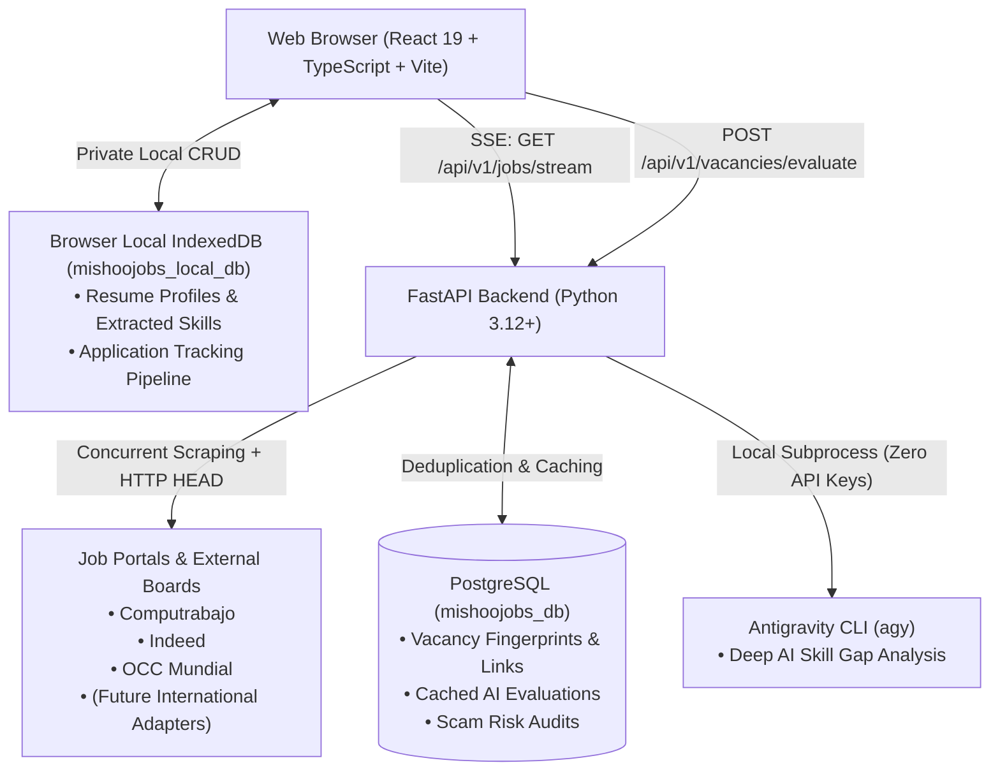

# MishooJobs 🥑
### Real-Time Job Discovery & Verification Platform for Junior Developers & Students

[](https://www.python.org/)
[](https://fastapi.tiangolo.com/)
[](https://react.dev/)
[](https://www.typescriptlang.org/)
[](https://tailwindcss.com/)
[](LICENSE)

> A privacy-first, live job aggregation and verification platform for junior software engineers, interns, and students. Built with zero mandatory accounts, in-flight direct link health checks, local AI skill gap analysis, and a modular architecture ready for global expansion.

---

## ⚡ Core Guarantees & Architectural Principles

1. **Zero Accounts & Absolute Privacy**: No registration, no login walls, and zero candidate PII stored on the server. Your resume, parsed skills, and application tracking pipeline reside strictly in your browser (`IndexedDB`).
2. **100% Live Discovery (Zero Preloaded/Mock Data)**: Live, multi-portal concurrent queries via Server-Sent Events (SSE). No static or synthetic database listings served to users.
3. **100% Verified Active Links**: In-flight asynchronous HTTP HEAD health checks validate that every direct application URL is active and functional before rendering it on screen. Broken or expired listings are discarded automatically.
4. **Modular Multi-Region Architecture**: Initial release calibrates against regional boards (Computrabajo, Indeed, OCC) with localized compensation and academic internship formatting, architected modularly for global and international portal expansion in upcoming specifications.
5. **Zero-API-Key Deep AI Analysis**: Orchestrates on-demand skill gap analysis through the local Antigravity CLI (`agy`) using your active developer subscription, paired with composite-hash PostgreSQL caching for fast subsequent lookups.
6. **Anti-Scam & Predatory Postings Protection**: Deterministic detection rules engine flags pyramid schemes (MLM), candidate fees (uniforms, exams), 100% commission traps, and unpaid labor with high-contrast warning badges.
7. **Developer-First Aesthetic**: Dark developer palette (`zinc-950`/`zinc-900`), Geist Mono & Geist Pixel typography, high data density, and Vim-inspired keyboard navigation.

---

## 🏗️ System Architecture



---

## 🚀 Quickstart & Local Setup

### Prerequisites
- macOS or Linux
- Python 3.12+ (Python 3.14 verified)
- Node.js v20+ & npm
- PostgreSQL 15+ running locally on port 5432
- Antigravity CLI (`agy`) installed and available in PATH

### 1. Clone & Configure Backend

```bash
# Create and activate virtual environment
python3 -m venv .venv
source .venv/bin/activate

# Install backend dependencies in editable mode
pip install -e "./backend[dev]"

# Create the local PostgreSQL database
psql -d postgres -c "CREATE DATABASE mishoojobs_db;"

# Apply Alembic database migrations
cd backend
alembic upgrade head
cd ..
```

### 2. Configure Frontend

```bash
cd frontend
npm install
cd ..
```

### 3. Run in Development Mode

```bash
# Terminal 1: Start FastAPI backend (port 8000)
source .venv/bin/activate
uvicorn mishoojobs.api.main:app --reload --port 8000

# Terminal 2: Start Vite React frontend (port 5173)
cd frontend
npm run dev
```

Open your browser at `http://localhost:5173`.

---

## ⌨️ Keyboard Shortcuts (Fast Navigation)

| Key | Action |
|---|---|
| `/` | Focus search bar immediately |
| `j` or `↓` | Select next vacancy card |
| `k` or `↑` | Select previous vacancy card |
| `Enter` or `Space` | Open details and AI analysis modal |
| `s` | Save vacancy to local pipeline |
| `a` | Mark vacancy as applied |
| `Esc` | Close open modal dialogs |

---

## 🧪 Automated Testing

Automated test suites run 100% offline using deterministic static fixtures without live network calls:

```bash
# Run all backend unit, contract, and integration tests (19 tests)
.venv/bin/pytest backend/tests/ -v

# Run frontend Vitest component tests (3 tests)
cd frontend && npm test
```

---

## 📄 License
Distributed under the MIT License. Built with ❤️ for early-career developers, students, and juniors worldwide.
