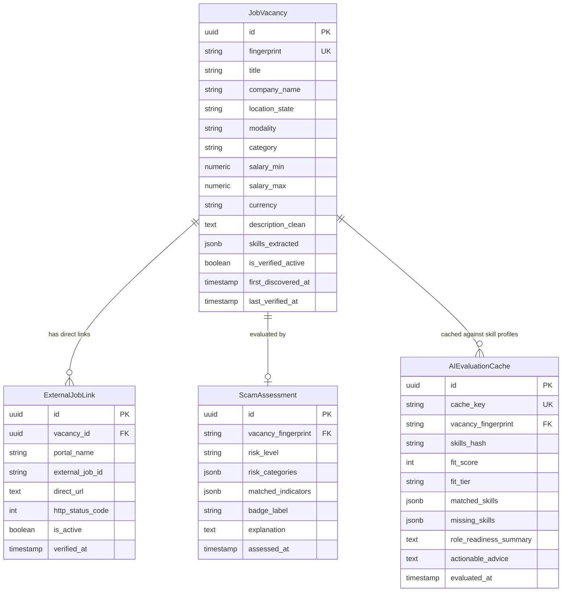

# Data Model: Real-Time Mexican Job Discovery & Verification (MishooJobs)

**Feature Branch**: `001-realtime-job-discovery`  
**Date**: 2026-11-05  
**Status**: Completed  
**Governing Documents**: `specs/001-realtime-job-discovery/spec.md`, `specs/001-realtime-job-discovery/research.md`, `.specify/memory/constitution.md`

---

## 1. Architectural Boundaries & Data Segregation

In accordance with **Constitution Principle I (Privacy & Zero Friction)** and **FR-007 (Local Candidate Privacy)**, candidate data and platform job data are strictly segregated across two distinct storage environments:

```
┌────────────────────────────────────────────────────────┐
│             CLIENT-SIDE BROWSER STORAGE                │
│             (IndexedDB / LocalStorage)                 │
│                                                        │
│  • CandidateProfile (Resumes, target roles, skills)    │
│  • ApplicationRecord (Pipeline states: saved, applied) │
│  • ActiveProfilePreference                             │
└───────────────────────────┬────────────────────────────┘
                            │ Ephemeral Skill Tokens
                            │ (No PII, No Resume Text)
                            ▼
┌────────────────────────────────────────────────────────┐
│             SERVER-SIDE POSTGRESQL DATABASE            │
│                 (SQLAlchemy 2.0 Async)                 │
│                                                        │
│  • JobVacancy (Canonical deduplicated live postings)   │
│  • ExternalJobLink (Verified portal direct links)      │
│  • ScamAssessment (Detected predatory flags & risks)   │
│  • AIEvaluationCache (Cached (vacancy, skills) fit)    │
└────────────────────────────────────────────────────────┘
```

---

## 2. Server-Side Entities (PostgreSQL)

### 2.1. `JobVacancy` (Canonical Job Posting)
Represents a unique, deduplicated job posting discovered in real time across Mexican job portals.

- **Storage**: Table `vacancies` in PostgreSQL
- **Fields**:
  - `id`: `UUID` (Primary Key, default `uuid4`)
  - `fingerprint`: `VARCHAR(64)` (Unique, Indexed) - SHA-256 hash of `norm_company:norm_title:norm_state`.
  - `title`: `VARCHAR(255)` - Cleaned job title (e.g., "Desarrollador Python Junior").
  - `company_name`: `VARCHAR(255)` - Cleaned hiring organization or recruiter.
  - `location_city`: `VARCHAR(100)` - City in Mexico (or empty if state-wide).
  - `location_state`: `VARCHAR(50)` - Standard Mexican 2-letter or standard state name (e.g., "CDMX", "JAL", "NL", "REMOTO").
  - `modality`: `ENUM('presencial', 'hibrido', 'remoto')` - Work arrangement.
  - `category`: `ENUM('becario', 'practicas', 'residencias', 'servicio_social', 'dualidad', 'trainee', 'junior')` - Mexican entry-level category.
  - `salary_min`: `NUMERIC(10, 2)` (Nullable) - Minimum salary in MXN.
  - `salary_max`: `NUMERIC(10, 2)` (Nullable) - Maximum salary in MXN.
  - `salary_period`: `ENUM('semanal', 'quincenal', 'mensual', 'anual')` (Nullable) - Compensation cadence.
  - `currency`: `VARCHAR(3)` - Default `"MXN"` (strictly enforced by Principle II).
  - `description_clean`: `TEXT` - Sanitized plain text description (XSS sanitized, no raw HTML).
  - `skills_extracted`: `JSONB` - Array of detected technical competencies (e.g., `["python", "fastapi", "sql"]`).
  - `is_verified_active`: `BOOLEAN` - True if in-flight HTTP HEAD checks confirmed active links.
  - `first_discovered_at`: `TIMESTAMP WITH TIME ZONE` - Timestamp of initial live discovery.
  - `last_verified_at`: `TIMESTAMP WITH TIME ZONE` - Timestamp of latest HTTP health check.

- **Validation Rules**:
  - `fingerprint` must match `^[a-f0-9]{16,64}$`.
  - `currency` must be `"MXN"`.
  - If `salary_min` and `salary_max` are both present, `salary_max >= salary_min`.
  - Description must be sanitized via Bleach before database insertion.

---

### 2.2. `ExternalJobLink` (Portal Source Link)
Represents a verified, active direct application URL from a specific Mexican job portal.

- **Storage**: Table `external_links` in PostgreSQL
- **Fields**:
  - `id`: `UUID` (Primary Key)
  - `vacancy_id`: `UUID` (Foreign Key -> `vacancies.id` ON DELETE CASCADE)
  - `portal_name`: `ENUM('computrabajo', 'indeed', 'occ')` - Source board.
  - `external_job_id`: `VARCHAR(100)` - Portal-specific identifier (e.g. Indeed `jk` parameter).
  - `direct_url`: `TEXT` - Fully qualified URL pointing directly to the live listing.
  - `http_status_code`: `INTEGER` - Last verified HTTP status code (200, 301, 302).
  - `is_active`: `BOOLEAN` - True if link is confirmed functional.
  - `verified_at`: `TIMESTAMP WITH TIME ZONE` - Last check timestamp.

- **Validation Rules**:
  - `direct_url` must be a valid HTTP/HTTPS URL belonging to the declared portal domain.
  - `http_status_code` must be `< 400`.

---

### 2.3. `ScamAssessment` (Predatory Pattern Audit)
Stores safety classifications and flags for Mexican labor protection.

- **Storage**: Table `scam_assessments` in PostgreSQL
- **Fields**:
  - `id`: `UUID` (Primary Key)
  - `vacancy_fingerprint`: `VARCHAR(64)` (Foreign Key -> `vacancies.fingerprint`)
  - `risk_level`: `ENUM('safe', 'warning', 'critical')`
  - `risk_categories`: `JSONB` - Array of detected risk strings (`["MLM_SCHEME", "CANDIDATE_FEE", "COMMISSION_ONLY", "UNPAID_LABOR", "FOREIGN_VISA_RESTRICTION"]`).
  - `matched_indicators`: `JSONB` - Specific phrases that triggered the rule (e.g. `["sé tu propio jefe", "3000 a 5000 semanales"]`).
  - `badge_label`: `VARCHAR(100)` - High-contrast badge display text in Mexican Spanish (e.g. `[POSIBLE FRAUDE / PIRAMIDAL]`).
  - `explanation`: `TEXT` - Plain-language warning for junior candidates.
  - `assessed_at`: `TIMESTAMP WITH TIME ZONE`

- **Validation Rules**:
  - If `risk_level == 'critical'`, `risk_categories` must contain at least one of `MLM_SCHEME` or `CANDIDATE_FEE`.
  - If `risk_categories` includes `FOREIGN_VISA_RESTRICTION`, the vacancy is excluded from candidate feeds.

---

### 2.4. `AIEvaluationCache` (Cached LLM Compatibility Analysis)
Caches Tier 2 deep AI evaluations produced by the local `agy` CLI to prevent duplicate LLM calls.

- **Storage**: Table `ai_evaluation_cache` in PostgreSQL
- **Fields**:
  - `id`: `UUID` (Primary Key)
  - `cache_key`: `VARCHAR(128)` (Unique, Indexed) - Composite hash: `sha256(f"{vacancy_fingerprint}:{sorted_skills_hash}")`.
  - `vacancy_fingerprint`: `VARCHAR(64)` (Indexed)
  - `skills_hash`: `VARCHAR(64)` - SHA-256 hash of candidate's canonical skill tokens.
  - `fit_score`: `INTEGER` - 0 to 100 compatibility rating.
  - `fit_tier`: `ENUM('high', 'moderate', 'low')` - High (>=80), Moderate (50-79), Low (<50).
  - `matched_skills`: `JSONB` - Array of strings matching candidate competencies.
  - `missing_skills`: `JSONB` - Array of missing competencies required by the job.
  - `role_readiness_summary`: `TEXT` - Concise AI assessment of profile suitability.
  - `actionable_advice`: `TEXT` - Targeted advice for the student on bridging skill gaps.
  - `evaluated_at`: `TIMESTAMP WITH TIME ZONE`

- **Validation Rules**:
  - `fit_score` between 0 and 100 inclusive.
  - Cache entries expire after 14 days to account for evolving market requirements.

---

## 3. Client-Side Entities (IndexedDB)

### 3.1. `CandidateProfile`
Represents candidate credentials, resume, and skills stored strictly on the user's workstation.

- **Storage**: Object Store `candidate_profiles` in browser IndexedDB
- **Fields**:
  - `id`: `string` (UUID generated in browser)
  - `name`: `string` - Label (e.g., "CV Backend Python", "CV Data Science").
  - `target_role`: `string` - Desired title (e.g., "Junior Backend Developer").
  - `skills`: `string[]` - Extracted skill tokens (e.g., `["Python", "FastAPI", "PostgreSQL", "Docker", "Git"]`).
  - `coursework`: `string[]` - University courses (e.g., `["Estructuras de Datos", "Bases de Datos Relacionales"]`).
  - `projects`: `Array<{ title: string, description: string, technologies: string[] }>`
  - `raw_text`: `string` - Plain text content extracted from uploaded PDF or Markdown.
  - `created_at`: `string` (ISO timestamp)
  - `updated_at`: `string` (ISO timestamp)

- **Privacy Invariant**:
  - This object is NEVER sent to the backend as an entity. Only the `skills` array is transmitted ephemerally to `/api/v1/vacancies/evaluate` for compatibility scoring.

---

### 3.2. `ApplicationRecord`
Tracks local pipeline progression for discovered vacancies.

- **Storage**: Object Store `applications` in browser IndexedDB
- **Fields**:
  - `vacancy_fingerprint`: `string` (Primary Key)
  - `title`: `string`
  - `company_name`: `string`
  - `status`: `ENUM('new', 'saved', 'applied', 'interviewing', 'rejected', 'ignored')`
  - `direct_url`: `string` - Primary external link to original job board.
  - `notes`: `string` - Candidate personal notes.
  - `fit_score`: `number` (0-100)
  - `applied_at`: `string | null` (ISO timestamp)
  - `updated_at`: `string` (ISO timestamp)

- **State Transitions**:
```
  [Discovered / New]
         │
         ├───► [Saved] ───────────► [Applied] ───► [Interviewing] ───► [Rejected]
         │        ▲                     │
         │        └─────────────────────┘
         │
         └───► [Ignored] (Excluded from future search feeds)
```

---

## 4. Entity Relationships Diagram


