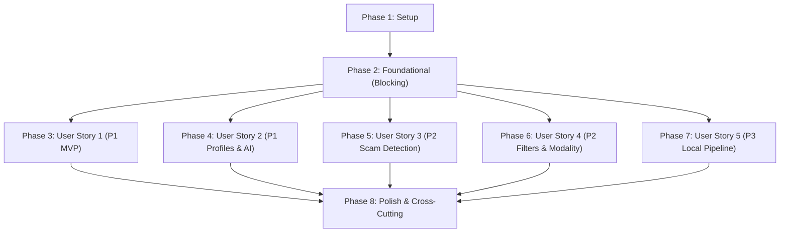

# Tasks: Real-Time Mexican Job Discovery & Verification for Juniors (MishooJobs)

**Input**: Design documents from `/specs/001-realtime-job-discovery/`  
**Prerequisites**: plan.md (required), spec.md (required for user stories), research.md, data-model.md, contracts/  
**Constitution**: Governed by MishooJobs Constitution v1.1.0 (`.specify/memory/constitution.md`)  
**Tests**: Automated tests use deterministic offline fixtures in `tests/fixtures/` with zero live network calls.

## Format: `[ID] [P?] [Story] Description with file path`

- **[P]**: Can run in parallel (different files, no dependencies)
- **[Story]**: Which user story this task belongs to (e.g., US1, US2, US3, US4, US5)
- Include exact file paths in descriptions

---

## Phase 1: Setup (Shared Infrastructure)

**Purpose**: Project initialization, tooling configuration, and test fixtures

- [X] T001 Initialize Python backend project structure with `backend/pyproject.toml` configuring Python 3.12+, FastAPI, Pydantic v2, Uvicorn, HTTPX, BeautifulSoup4, Bleach, SQLAlchemy 2.0 async, Asyncpg, Alembic, and pytest
- [X] T002 [P] Initialize React 19 + Vite + TypeScript (Strict Mode) frontend project with Tailwind CSS, Lucide React, pdfjs-dist, and Dexie in `frontend/package.json`, `frontend/tsconfig.json`, `frontend/vite.config.ts`, and `frontend/tailwind.config.js`
- [X] T003 [P] Configure backend linting (Ruff/Flake8), formatting, and pytest configuration in `backend/pyproject.toml` and frontend test harness in `frontend/vitest.config.ts` and `frontend/tests/setup.ts`
- [X] T004 [P] Create recorded static HTML/JSON test fixtures (`computrabajo_raw.html`, `indeed_raw.html`, `occ_raw.html`, `agy_eval_response.json`) in `backend/tests/fixtures/` and base test configuration in `backend/tests/conftest.py`

---

## Phase 2: Foundational (Blocking Prerequisites)

**Purpose**: Core infrastructure that MUST be complete before ANY user story can be implemented

**⚠️ CRITICAL**: No user story work can begin until this phase is complete

- [X] T005 Implement typed configuration management with Pydantic Settings (database async URL, CORS origins, agy CLI executable path, per-portal timeouts) in `backend/src/mishoojobs/config.py`
- [X] T006 [P] Implement SQLAlchemy 2.0 async engine and session factory with asyncpg in `backend/src/mishoojobs/database.py`
- [X] T007 [P] Configure Alembic async database migration environment in `backend/alembic.ini` and `backend/alembic/env.py`
- [X] T008 [P] Implement common Pydantic v2 error schemas and health response schemas (`status`, `database`, `agy_cli`, `timestamp`) in `backend/src/mishoojobs/schemas/job.py`
- [X] T009 Create FastAPI application factory with CORS middleware, XSS protection headers, exception handlers, and health check route `GET /api/v1/health` in `backend/src/mishoojobs/api/main.py` and `backend/src/mishoojobs/api/routes/health.py`
- [X] T010 [P] Setup client-side IndexedDB database initialization with Dexie for `mishoojobs_local_db` (version 1) defining stores `candidate_profiles` (`id`, `&created_at`, `name`), `applications` (`vacancy_fingerprint`, `status`, `updated_at`), and `preferences` (`key`) in `frontend/src/db/index.ts`
- [X] T011 [P] Configure Tailwind design tokens (`bg-zinc-950` canvas, `bg-zinc-900` cards, `border-zinc-800`, Geist Mono body, Geist Pixel display) and base layout shell in `frontend/src/index.css` and `frontend/src/App.tsx`

**Checkpoint**: Foundation ready - user story implementation can now begin in parallel

---

## Phase 3: User Story 1 - Real-Time Job Sourcing with Functional Direct Links (Priority: P1) 🎯 MVP

**Goal**: Query Mexican job portals (Computrabajo, Indeed México, OCC Mundial) concurrently in real time, verify active direct URLs in-flight via HTTP HEAD, deduplicate cross-posted vacancies, and stream verified vacancies portal-by-portal via SSE with live progress indicators and zero preloaded data.

**Independent Test**: Perform a search for role keywords (e.g. "Python Junior") and location (e.g. "Guadalajara"). Verify SSE stream begins emitting verified vacancy batches within <5s with working direct URLs (`is_active: true`, HTTP 200/302), deduplicates cross-portal postings, and contains 0 synthetic mock records.

### Tests for User Story 1

- [X] T012 [P] [US1] Create unit tests validating offline parsing of Computrabajo, Indeed, and OCC HTML fixtures in `backend/tests/unit/test_scrapers.py`
- [X] T013 [P] [US1] Create unit tests for in-flight HTTP HEAD URL verification, redirects, and 405 range-GET fallback in `backend/tests/unit/test_verifier.py`
- [X] T014 [P] [US1] Create unit tests for cross-portal deduplication fingerprinting and merge logic in `backend/tests/unit/test_deduplicator.py`
- [X] T015 [P] [US1] Create integration test for progressive SSE job streaming with mock scraper responses in `backend/tests/integration/test_sse_stream.py`

### Implementation for User Story 1

- [X] T016 [P] [US1] Create SQLAlchemy database models `JobVacancy` (table `vacancies`: `id UUID PK default uuid4`, `fingerprint VARCHAR(64) UNIQUE INDEXED matching ^[a-f0-9]{16,64}$`, `title VARCHAR(255)`, `company_name VARCHAR(255)`, `location_city VARCHAR(100) NULL`, `location_state VARCHAR(50)`, `modality ENUM('presencial', 'hibrido', 'remoto')`, `category ENUM('becario', 'practicas', 'residencias', 'servicio_social', 'dualidad', 'trainee', 'junior')`, `salary_min NUMERIC(10,2) NULL`, `salary_max NUMERIC(10,2) NULL`, `salary_period ENUM('semanal', 'quincenal', 'mensual', 'anual') NULL`, `currency VARCHAR(3) DEFAULT 'MXN'`, `description_clean TEXT`, `skills_extracted JSONB`, `is_verified_active BOOLEAN`, `first_discovered_at TIMESTAMP WITH TIME ZONE`, `last_verified_at TIMESTAMP WITH TIME ZONE`, constraint `salary_max >= salary_min`) and `ExternalJobLink` (table `external_links`: `id UUID PK`, `vacancy_id UUID FK -> vacancies.id ON DELETE CASCADE`, `portal_name ENUM('computrabajo', 'indeed', 'occ')`, `external_job_id VARCHAR(100)`, `direct_url TEXT`, `http_status_code INTEGER < 400`, `is_active BOOLEAN`, `verified_at TIMESTAMP WITH TIME ZONE`) in `backend/src/mishoojobs/models/vacancy.py`
- [X] T017 [P] [US1] Create Pydantic v2 schemas `VacancyDTO` (with field validation aliases for `description_clean` -> `description` and `skills_extracted` -> `skills`), `ExternalLinkDTO`, `SearchParams`, and `PortalStatusEvent` adhering to `specs/001-realtime-job-discovery/contracts/openapi.yaml` in `backend/src/mishoojobs/schemas/job.py`
- [X] T018 [US1] Create and apply Alembic migration for `vacancies` and `external_links` tables in `backend/alembic/versions/001_create_vacancies_and_links.py` (depends on T016)
- [X] T019 [P] [US1] Implement `AbstractBaseScraper` class with async HTTP requests (`httpx`), retry logic with Tenacity, Bleach HTML sanitization, and optional secondary adapter hook for Apify MCP in `backend/src/mishoojobs/services/scrapers/base.py`
- [X] T020 [P] [US1] Implement Computrabajo México scraper extracting up to 15 vacancies using `article.box_offer` card selectors and `a.js-o-link` direct links in `backend/src/mishoojobs/services/scrapers/computrabajo.py`
- [X] T021 [P] [US1] Implement Indeed México scraper extracting up to 15 vacancies using `div.job_seen_beacon` selectors and direct `viewjob?jk=` links in `backend/src/mishoojobs/services/scrapers/indeed.py`
- [X] T022 [P] [US1] Implement OCC Mundial scraper extracting up to 15 vacancies using `div[id^="jobcard-"]` and `a[href*="/empleo/oferta/"]` selectors in `backend/src/mishoojobs/services/scrapers/occ.py`
- [X] T023 [P] [US1] Implement in-flight asynchronous URL verification service performing HTTP HEAD checks with `asyncio.Semaphore(15)` and 2.5s timeout in `backend/src/mishoojobs/services/verifier.py`
- [X] T024 [P] [US1] Implement cross-portal deduplication service generating canonical fingerprint `sha256(f"{norm_company}:{norm_title}:{norm_state}")` and merging links/salaries in `backend/src/mishoojobs/services/deduplicator.py`
- [X] T025 [US1] Implement progressive SSE stream generator executing portal scrapers concurrently and yielding typed `portal_status`, `vacancy_batch`, and `stream_end` events in `backend/src/mishoojobs/api/sse.py`
- [X] T026 [US1] Implement `GET /api/v1/jobs/stream` endpoint accepting `query`, `location`, `modality`, `category`, and `limit_per_portal` (capped at 15) returning `StreamingResponse` in `backend/src/mishoojobs/api/routes/jobs.py`
- [X] T027 [P] [US1] Define TypeScript types `JobVacancy`, `ExternalLink`, and `PortalStatus` in `frontend/src/types/job.ts`
- [X] T028 [P] [US1] Implement SSE stream consumer service with EventSource/Fetch ReadableStream and event parsing in `frontend/src/services/sse.ts`
- [X] T029 [US1] Implement `useJobStream` custom React hook managing live search lifecycle, portal status pills, and verified vacancy accumulation in `frontend/src/hooks/useJobStream.ts`
- [X] T030 [P] [US1] Implement `Header` component with Geist Pixel brand logo, live connection status, and keyboard shortcut hints in `frontend/src/components/Header.tsx`
- [X] T031 [P] [US1] Implement `SearchBar` component with autofocus shortcut `/` and query submission in `frontend/src/components/SearchBar.tsx`
- [X] T032 [P] [US1] Implement `PortalStatusBar` component rendering live progress badges (Buscando, Listo, Timeout) for Computrabajo, Indeed, and OCC in `frontend/src/components/PortalStatusBar.tsx`
- [X] T033 [P] [US1] Implement `VacancyCard` component rendering verified functional direct links, company name, location, and MXN salary in `frontend/src/components/VacancyCard.tsx`
- [X] T034 [US1] Implement `VacancyList` high-density grid component displaying live streamed vacancy cards in `frontend/src/components/VacancyList.tsx`
- [X] T035 [US1] Integrate live search and progressive SSE streaming into main layout in `frontend/src/App.tsx`

**Checkpoint**: User Story 1 (MVP) is fully functional and independently testable

---

## Phase 4: User Story 2 - Privacy-First Resume Profile Matching & Skill Gap Analysis (Priority: P1)

**Goal**: Allow candidates to upload resumes (PDF/Markdown) into client-side IndexedDB without an account, calculate instant (<2s) heuristic compatibility scores across all search cards, and run on-demand deep AI skill gap analysis (<5s) via local `agy` CLI with PostgreSQL caching.

**Independent Test**: Load a sample resume (e.g. `docs/samples/sample_resume_backend.md`). Verify all vacancy cards render heuristic fit scores in <2s, and clicking "Evaluar con IA" on a card executes `POST /api/v1/vacancies/evaluate` via `agy` CLI, displaying matched skills, skill gaps, and learning advice, with subsequent clicks resolving in <20ms from PostgreSQL cache.

### Tests for User Story 2

- [X] T036 [P] [US2] Create unit tests for weighted Jaccard heuristic compatibility scorer in `backend/tests/unit/test_heuristic_scorer.py`
- [X] T037 [P] [US2] Create integration test for `agy` CLI subprocess execution and `ai_evaluation_cache` persistence in `backend/tests/integration/test_ai_evaluation.py`

### Implementation for User Story 2

- [X] T038 [P] [US2] Create SQLAlchemy database model `AIEvaluationCache` (table `ai_evaluation_cache`: `id UUID PK`, `cache_key VARCHAR(128) UNIQUE INDEXED matching sha256(vacancy_fingerprint + ':' + norm_target_role + ':' + sorted_skills_hash)`, `vacancy_fingerprint VARCHAR(64) INDEXED`, `target_role VARCHAR(100)`, `skills_hash VARCHAR(64)`, `fit_score INTEGER 0-100 INCLUSIVE`, `fit_tier ENUM('high', 'moderate', 'low')`, `matched_skills JSONB`, `missing_skills JSONB`, `role_readiness_summary TEXT`, `actionable_advice TEXT`, `evaluated_at TIMESTAMP WITH TIME ZONE`, TTL 14 days expiration) in `backend/src/mishoojobs/models/evaluation.py`
- [X] T039 [P] [US2] Create Pydantic v2 schemas `AIEvaluationRequest` and `AIEvaluationResponse` conforming to `specs/001-realtime-job-discovery/contracts/openapi.yaml` in `backend/src/mishoojobs/schemas/evaluation.py`
- [X] T040 [US2] Create and apply Alembic migration for `ai_evaluation_cache` table in `backend/alembic/versions/002_create_ai_evaluation_cache.py` (depends on T038)
- [X] T041 [P] [US2] Implement fast heuristic skill matcher service calculating weighted token overlap in `backend/src/mishoojobs/services/heuristic_scorer.py`
- [X] T042 [P] [US2] Implement local `agy` CLI client runner executing `agy --print "{prompt}" --output-format json` with prompt optimization for <5s SLA (SC-008), 8s timeout safeguard, zero paid API keys, and JSON parsing per `specs/001-realtime-job-discovery/contracts/agy-eval.json` in `backend/src/mishoojobs/services/agy_ai_client.py`
- [X] T043 [US2] Implement `POST /api/v1/vacancies/evaluate` endpoint checking PostgreSQL `ai_evaluation_cache` first, invoking `agy` CLI on cache miss, and persisting evaluation in `backend/src/mishoojobs/api/routes/vacancies.py`
- [X] T044 [P] [US2] Define TypeScript interfaces for `CandidateProfile`, `SkillMatch`, and `AIEvaluation` in `frontend/src/types/profile.ts`
- [X] T045 [P] [US2] Implement client-side resume parser extracting technical skills, target role, and coursework from Markdown and PDF files (via `pdfjs-dist`) in `frontend/src/services/resume_parser.ts`
- [X] T046 [P] [US2] Implement client-side heuristic compatibility scorer calculating instant 0-100% scores (<5ms per card) in `frontend/src/services/heuristic_scorer.ts`
- [X] T047 [P] [US2] Implement API client function for `POST /api/v1/vacancies/evaluate` in `frontend/src/services/api.ts`
- [X] T048 [US2] Create `useProfiles` React hook for IndexedDB CRUD operations on `candidate_profiles` and active profile selection in `frontend/src/hooks/useProfiles.ts`
- [X] T049 [P] [US2] Implement `FitScoreBadge` component displaying High (80-100%), Moderate (50-79%), or Low (<50%) badges in `frontend/src/components/FitScoreBadge.tsx`
- [X] T050 [US2] Implement `ProfileManagerModal` component for uploading resumes, viewing extracted skills, and switching profiles in `frontend/src/components/ProfileManagerModal.tsx`
- [X] T051 [US2] Implement `VacancyDetailModal` component rendering detailed vacancy inspection, on-demand AI evaluation trigger, and matched skills vs. missing skill gaps in `frontend/src/components/VacancyDetailModal.tsx`

**Checkpoint**: User Stories 1 and 2 operate together seamlessly with instant heuristic matching and on-demand deep AI analysis

---

## Phase 5: User Story 3 - Predatory & Scam Vacancy Detection for Mexican Labor Context (Priority: P2)

**Goal**: Identify fraudulent, exploitative, and predatory job postings (pyramid schemes/MLMs, candidate fees, commission-only traps, unpaid full-time labor, foreign visa restrictions) and render high-contrast warning badges.

**Independent Test**: Provide vacancies containing known predatory phrases (e.g. "3000 a 5000 semanales por actividades sencillas de oficina", "pago de uniforme", "US Citizen only"). Verify the detector flags them with severity `critical` or `warning`, displays badges (`[POSIBLE FRAUDE / PIRAMIDAL]`, `[COBRO A CANDIDATO]`), and excludes foreign visa listings from candidate feed.

### Tests for User Story 3

- [X] T052 [P] [US3] Create unit tests for Mexican labor scam and foreign visa exclusion rules engine in `backend/tests/unit/test_scam_detector.py`

### Implementation for User Story 3

- [X] T053 [P] [US3] Create SQLAlchemy database model `ScamAssessment` (table `scam_assessments`: `id UUID PK`, `vacancy_fingerprint VARCHAR(64) FK -> vacancies.fingerprint`, `risk_level ENUM('safe', 'warning', 'critical')`, `risk_categories JSONB`, `matched_indicators JSONB`, `badge_label VARCHAR(100)`, `explanation TEXT`, `assessed_at TIMESTAMP WITH TIME ZONE`, validation: if `risk_level == 'critical'` then `risk_categories` contains `MLM_SCHEME` or `CANDIDATE_FEE`) in `backend/src/mishoojobs/models/scam.py`
- [X] T054 [P] [US3] Create Pydantic v2 schemas `ScamReportResponse` and `RiskLevelEnum` in `backend/src/mishoojobs/schemas/scam.py`
- [X] T055 [US3] Create and apply Alembic migration for `scam_assessments` table in `backend/alembic/versions/003_create_scam_assessments.py` (depends on T053)
- [X] T056 [US3] Implement deterministic regex-based scam detector engine checking categories `MLM_SCHEME`, `CANDIDATE_FEE`, `COMMISSION_ONLY`, `UNPAID_LABOR`, and `FOREIGN_VISA_RESTRICTION` in `backend/src/mishoojobs/services/scam_detector.py`
- [X] T057 [US3] Integrate scam assessment into the scraping/SSE stream pipeline and implement `GET /api/v1/vacancies/{fingerprint}/scam-report` in `backend/src/mishoojobs/api/routes/vacancies.py`
- [X] T058 [P] [US3] Implement `ScamBadge` high-contrast visual component (`bg-rose-950 border-rose-500 text-rose-200` for critical, `bg-amber-950 border-amber-500 text-amber-200` for warning) in `frontend/src/components/ScamBadge.tsx`
- [X] T059 [US3] Integrate `ScamBadge` into `VacancyCard.tsx` and detailed explanatory alert in `VacancyDetailModal.tsx`

**Checkpoint**: Predatory and exploitative Mexican postings are proactively flagged with high-contrast warning badges

---

## Phase 6: User Story 4 - Dynamic Filtering by Mexican Modality & Early-Career Role Types (Priority: P2)

**Goal**: Enable filtering live opportunities by Mexican academic/entry-level formats (*becario, prácticas profesionales, residencias profesionales, servicio social, dualidad, trainee, junior*) and modality (remote, hybrid, on-site by Mexican state), strictly enforcing currency in MXN ($) and excluding foreign work visa restrictions.

**Independent Test**: Filter by "Prácticas Profesionales" and "Modalidad: Remoto". Verify returned stream contains only Mexican internship vacancies with compensation in MXN, and excludes listings with foreign visa restrictions ("US Citizen only").

### Implementation for User Story 4

- [X] T060 [US4] Implement query parameter validation, Mexican 32-state geographic dictionary/enum (e.g. `CDMX`, `JAL`, `NL`, plus `REMOTO`), and filter logic for Mexican academic categories and modalities enforcing geographic boundaries (FR-015, SC-003) in `backend/src/mishoojobs/schemas/job.py` and `backend/src/mishoojobs/services/scrapers/base.py`
- [X] T061 [US4] Implement Mexican compensation parser normalizing weekly, bi-weekly (*quincenal*), and monthly (*mensual*) rates to standard MXN ($) in `backend/src/mishoojobs/services/scrapers/base.py`
- [X] T062 [P] [US4] Implement `FilterDrawer` component with toggle pills for modality (`remoto`, `hibrido`, `presencial`), Mexican academic categories, and Mexican state selector in `frontend/src/components/FilterDrawer.tsx`
- [X] T063 [US4] Connect filter selections with `useJobStream` hook to re-query SSE stream upon filter changes in `frontend/src/App.tsx`

**Checkpoint**: Modality, academic role types, and Mexican regional filters refine live streams accurately

---

## Phase 7: User Story 5 - Local Application State Tracking & Management (Priority: P3)

**Goal**: Allow candidates to assign and track application states (`Saved`, `Applied`, `Interviewing`, `Rejected`, `Ignored`) in browser IndexedDB, preventing previously processed vacancies from cluttering future searches.

**Independent Test**: Mark a vacancy as `Applied` and another as `Ignored`. Execute a new search: verify the `Applied` vacancy reflects its status and `Ignored` vacancy is hidden from fresh search results, while confirming zero candidate data exists in PostgreSQL.

### Implementation for User Story 5

- [X] T064 [P] [US5] Define TypeScript interfaces for `ApplicationRecord` and `ApplicationStatus` (`new`, `saved`, `applied`, `interviewing`, `rejected`, `ignored`) in `frontend/src/types/application.ts`
- [X] T065 [US5] Implement `useApplications` React hook for IndexedDB operations on `applications` store in `frontend/src/hooks/useApplications.ts`
- [X] T066 [P] [US5] Implement status action buttons (Guardar, Postulado, Descartar) on vacancy cards in `frontend/src/components/VacancyCard.tsx` and `frontend/src/components/VacancyDetailModal.tsx`
- [X] T067 [US5] Implement `PipelineView` component displaying applications grouped by status (Guardadas, Postuladas, En Entrevista, Rechazadas) with direct external links in `frontend/src/components/PipelineView.tsx`
- [X] T068 [US5] Connect pipeline status filtering into search feed to exclude ignored listings in `frontend/src/hooks/useJobStream.ts`

**Checkpoint**: Complete candidate application lifecycle is tracked locally without server accounts

---

## Phase 8: Polish & Cross-Cutting Concerns

**Purpose**: Developer ergonomics, keyboard navigation, comprehensive tests, and documentation

- [X] T069 [P] Implement keyboard navigation hook supporting shortcuts (`/` search, `j`/`k` select card, `Enter`/`Space` inspect, `s` save, `a` mark applied, `Esc` close) in `frontend/src/hooks/useKeyboardNavigation.ts`
- [X] T070 [P] Add sample candidate resume fixtures (`sample_resume_backend.md`, `sample_resume_frontend.md`) in `docs/samples/`
- [X] T071 [P] Implement comprehensive backend integration tests running against static fixtures in `backend/tests/integration/test_full_workflow.py`
- [X] T072 [P] Implement frontend component unit tests for `VacancyCard`, `ScamBadge`, and `FitScoreBadge` in `frontend/tests/components/VacancyCard.test.tsx`
- [X] T073 Execute end-to-end quickstart validation scenarios 1 through 4 per `specs/001-realtime-job-discovery/quickstart.md`
- [X] T074 Create project README with architecture diagram, local setup instructions, and Constitution adherence report in `README.md`

---

## Dependencies & Execution Order

### Phase Dependencies



- **Setup (Phase 1)**: No dependencies - executes immediately.
- **Foundational (Phase 2)**: Depends on Setup (Phase 1) - **BLOCKS** all user stories.
- **User Story 1 (Phase 3 - MVP)**: Depends on Foundational (Phase 2).
- **User Story 2 (Phase 4)**: Depends on Foundational (Phase 2). Integrates with US1 cards for heuristic badges and detail modals.
- **User Story 3 (Phase 5)**: Depends on Foundational (Phase 2). Integrates into US1 scrapers and card badges.
- **User Story 4 (Phase 6)**: Depends on Foundational (Phase 2). Refines US1 search streams.
- **User Story 5 (Phase 7)**: Depends on Foundational (Phase 2). Augments US1 cards with local tracking states.
- **Polish (Phase 8)**: Depends on user stories being implemented.

### Parallel Opportunities

- Within Phase 1: `T002`, `T003`, `T004` can execute concurrently once `T001` starts.
- Within Phase 2: `T006`, `T007`, `T008`, `T010`, `T011` can execute in parallel.
- Within Phase 3 (US1):
  - Tests `T012`, `T013`, `T014`, `T015` can be authored concurrently before implementation.
  - Scrapers `T020` (Computrabajo), `T021` (Indeed), `T022` (OCC) operate on separate files and can run in parallel.
  - Verifier `T023` and Deduplicator `T024` are independent modules and can run in parallel.
  - Frontend components `T030`, `T031`, `T032`, `T033` can be developed in parallel with backend services.
- Within Phase 4 (US2):
  - Heuristic scorer `T041` and `agy` CLI client `T042` can run in parallel.
  - Frontend resume parser `T045`, client scorer `T046`, and `FitScoreBadge` `T049` can run in parallel.
- Across stories: Once Phase 2 completes, US1, US2, US3, US4, and US5 can be developed in parallel work streams.

---

## Parallel Execution Examples

### User Story 1 (Sourcing & Streaming)

```bash
# Parallel Scrapers & Core Services:
Task: "Implement Computrabajo México scraper in backend/src/mishoojobs/services/scrapers/computrabajo.py"
Task: "Implement Indeed México scraper in backend/src/mishoojobs/services/scrapers/indeed.py"
Task: "Implement OCC Mundial scraper in backend/src/mishoojobs/services/scrapers/occ.py"
Task: "Implement in-flight URL verifier in backend/src/mishoojobs/services/verifier.py"

# Parallel UI Components:
Task: "Implement Header in frontend/src/components/Header.tsx"
Task: "Implement SearchBar in frontend/src/components/SearchBar.tsx"
Task: "Implement PortalStatusBar in frontend/src/components/PortalStatusBar.tsx"
Task: "Implement VacancyCard in frontend/src/components/VacancyCard.tsx"
```

### User Story 2 (Profiles & AI Matching)

```bash
# Parallel Backend & Frontend Services:
Task: "Implement heuristic skill matcher in backend/src/mishoojobs/services/heuristic_scorer.py"
Task: "Implement agy CLI client runner in backend/src/mishoojobs/services/agy_ai_client.py"
Task: "Implement client-side resume parser in frontend/src/services/resume_parser.ts"
Task: "Implement FitScoreBadge in frontend/src/components/FitScoreBadge.tsx"
```

---

## Implementation Strategy

### MVP First (User Story 1 Only)

1. Complete **Phase 1: Setup** (`T001` - `T004`).
2. Complete **Phase 2: Foundational** (`T005` - `T011`).
3. Complete **Phase 3: User Story 1** (`T012` - `T035`).
4. **STOP and VALIDATE**: Verify live real-time search across Computrabajo, Indeed, and OCC with active functional direct links, SSE streaming, and zero mock data.
5. Deploy/Demo initial MVP!

### Incremental Delivery

1. **Increment 1 (MVP)**: Phase 1 + Phase 2 + Phase 3 (Live discovery with verified functional links).
2. **Increment 2**: Phase 4 (Privacy-first resume matching, local heuristic scores, and on-demand deep AI analysis via `agy`).
3. **Increment 3**: Phase 5 (Mexican labor scam warning badges and foreign visa exclusions).
4. **Increment 4**: Phase 6 (Mexican modality, academic role types, and regional filters).
5. **Increment 5**: Phase 7 (Local IndexedDB pipeline tracking without accounts).
6. **Increment 6**: Phase 8 (Keyboard shortcuts, developer aesthetic polish, and end-to-end documentation).

---

## Notes

- Strict adherence to checklist format: `- [ ] [TaskID] [P?] [Story?] Description with file path`.
- Zero mandatory account registration (Constitution Principle I).
- 100% live job discovery with zero preloaded data (FR-001, Constitution Principle I).
- In-flight HTTP HEAD checks guarantee 100% active functional direct links (FR-002).
- Zero paid Gemini API keys: all AI evaluation delegates to local `agy` CLI (Constitution Principle V).
- Currency is exclusively Mexican Pesos (MXN, $) (Constitution Principle II).
