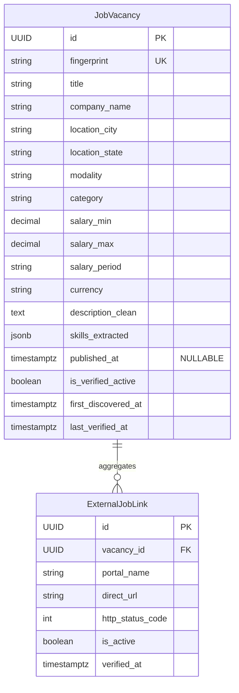
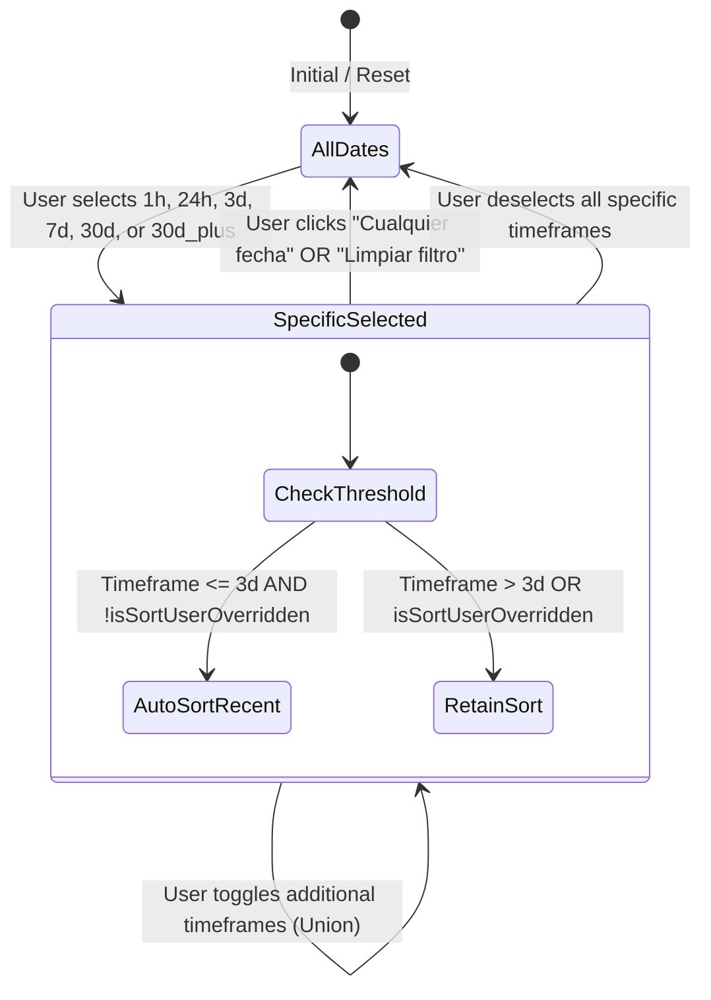
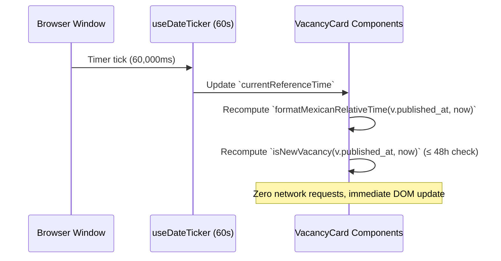

# Data Model: Date-Relevant Vacancy Filters (MishooJobs)

**Feature**: `002-date-vacancy-filters`  
**Date**: 2026-11-06  
**Status**: Complete  

---

## 1. Entity Overview



---

## 2. Backend Data Entities

### 2.1 `JobVacancy` (SQLAlchemy 2.0 Async Model)
- **Table**: `vacancies`
- **Updated Fields**:
  - `published_at: Mapped[Optional[datetime]]`: `DateTime(timezone=True)`, nullable, indexed for efficient recency ordering.
- **Constraints & Rules**:
  - Default: `None` (for unparseable or absent portal dates).
  - Timezone: UTC standard timezone (`timezone.utc`).
  - Index: `ix_vacancies_published_at` for ordering queries.

### 2.2 `VacancyDTO` (Pydantic v2 Schema)
- **Class**: `mishoojobs.schemas.job.VacancyDTO`
- **Updated Field**:
  - `published_at: Optional[datetime] = Field(default=None, description="Original publication timestamp in UTC. Null if unparseable or missing from portal.")`
- **Serialization**: Serializes to ISO 8601 string (e.g., `"2026-11-06T18:30:00Z"`) in SSE batches and API responses.

---

## 3. Frontend Data Entities & Interfaces

### 3.1 `TimeframeId` & `PublicationTimeframe`
Represents the available publication date filter options.

```typescript
export type TimeframeId =
  | "all"
  | "1h"
  | "24h"
  | "3d"
  | "7d"
  | "30d"
  | "30d_plus";

export interface PublicationTimeframe {
  id: TimeframeId;
  label: string;             // Localized label in Mexican Spanish
  description: string;       // Human-readable explanation
  maxAgeMs?: number;         // Cumulative age threshold ceiling
  minAgeMs?: number;         // Minimum age floor (e.g. for > 30 days)
  count: number;             // Cumulative matching vacancies in current search context
}
```

#### Timeframe Definition Matrix

| `id` | Label | Duration Filter Rule | Cumulative Behavior |
|------|-------|----------------------|---------------------|
| `all` | "Cualquier fecha" | No filter (age ≥ 0 or null) | Default, master reset |
| `1h` | "Última hora" | `ageMs <= 3,600,000` (≤ 1h) | Postings in past 60 min |
| `24h` | "Últimas 24 horas" | `ageMs <= 86,400,000` (≤ 24h) | Cumulative (includes ≤ 1h) |
| `3d` | "Últimos 3 días" | `ageMs <= 259,200,000` (≤ 72h) | Cumulative (includes ≤ 24h) |
| `7d` | "Última semana" | `ageMs <= 604,800,000` (≤ 7d) | Cumulative (includes ≤ 3d) |
| `30d` | "Último mes" | `ageMs <= 2,592,000,000` (≤ 30d) | Cumulative (includes ≤ 7d) |
| `30d_plus` | "Más de 1 mes" | `ageMs > 2,592,000,000` (> 30d) | Postings older than 30 days |

*Note*: Listings where `published_at == null` ONLY match `all`. They are excluded from all specific timeframes (`1h` through `30d_plus`).

---

### 3.2 `VacancyDateMetadata` (Computed Card Freshness)
Dynamically evaluated on the client on each card render or 60s ticker cycle.

```typescript
export interface VacancyDateMetadata {
  published_at?: string | null;
  relative_text: string;     // e.g. "Hace 2 horas", "Hace 3 días", "Fecha no especificada"
  is_new: boolean;           // True if published_at != null AND elapsed <= 48 hours
  age_ms?: number | null;    // Milliseconds elapsed since publication
}
```

#### Relative Text Resolution Rules (Mexican Spanish)

| Elapsed Time ($\Delta t$) | Generated UI String | "Nueva" Badge |
|---------------------------|---------------------|---------------|
| `published_at == null` | `"Fecha no especificada"` | ❌ No |
| $\Delta t < 60\text{ s}$ | `"Hace unos momentos"` | ✅ Sí |
| $60\text{ s} \le \Delta t < 3,600\text{ s}$ | `"Hace " + N + " minuto(s)"` | ✅ Sí |
| $1\text{ h} \le \Delta t < 24\text{ h}$ | `"Hace " + N + " hora(s)"` | ✅ Sí |
| $24\text{ h} \le \Delta t \le 48\text{ h}$ | `"Hace " + N + " día(s)"` | ✅ Sí |
| $48\text{ h} < \Delta t < 7\text{ d}$ | `"Hace " + N + " día(s)"` | ❌ No |
| $7\text{ d} \le \Delta t < 30\text{ d}$ | `"Hace " + N + " semana(s)"` | ❌ No |
| $\Delta t \ge 30\text{ d}$ | `"Hace más de 1 mes"` | ❌ No |

---

### 3.3 `SortOrder`
Represents the candidate's active sort criterion.

```typescript
export type SortOrder = "recent" | "compatibility" | "relevance";

export interface SortOption {
  id: SortOrder;
  label: string; // "Más recientes primero" | "Mayor compatibilidad (Fit Score)" | "Relevancia por defecto"
}
```

---

### 3.4 Extended `FilterState`
Extended client search filter configuration.

```typescript
export interface FilterState {
  modality: string;
  category: string;
  location: string;
  timeframes: TimeframeId[];   // Multi-select date filter (defaults to ["all"])
}
```

---

## 4. State Transitions & Lifecycle

### 4.1 Filter Selection State Machine



### 4.2 Auto-Ticker Cycle


