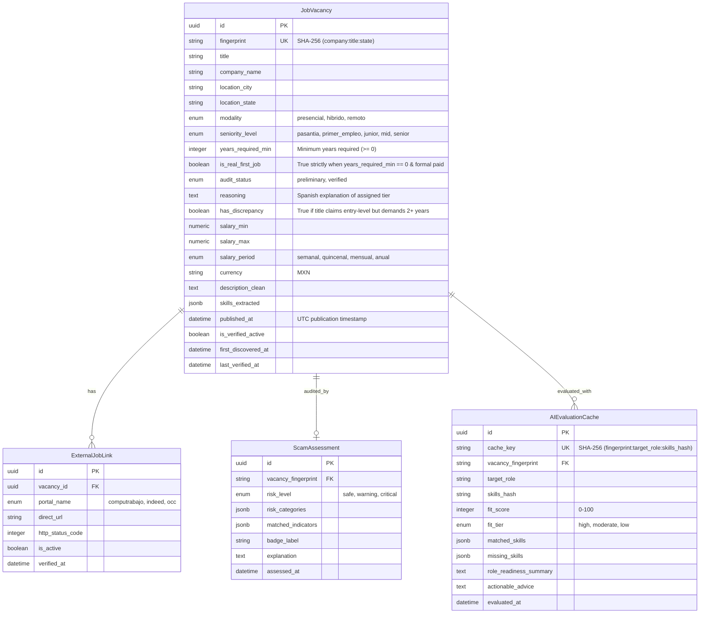
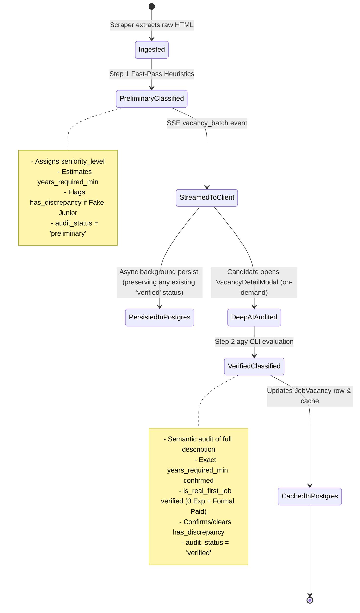

# Data Model: Smart Seniority Classification & "First REAL Job" Detection

**Feature Branch**: `003-smart-seniority-classification`  
**Date**: 2026-11-07  
**Status**: Completed  

---

## 1. Entities & Schema Changes

### 1.1 `JobVacancy` (PostgreSQL Table: `vacancies`)

The legacy column `category` and its associated PostgreSQL type `category_enum` are completely removed. The following columns and enums are added directly to `vacancies`:



### 1.2 PostgreSQL Data Types & Constraints

1. **`seniority_level_enum`**:
   ```sql
   CREATE TYPE seniority_level_enum AS ENUM (
       'pasantia',
       'primer_empleo',
       'junior',
       'mid',
       'senior'
   );
   ```
2. **`audit_status_enum`**:
   ```sql
   CREATE TYPE audit_status_enum AS ENUM (
       'preliminary',
       'verified'
   );
   ```
3. **Table Columns Added to `vacancies`**:
   - `seniority_level seniority_level_enum NOT NULL DEFAULT 'junior'`
   - `years_required_min INTEGER NOT NULL DEFAULT 0`
   - `is_real_first_job BOOLEAN NOT NULL DEFAULT FALSE`
   - `audit_status audit_status_enum NOT NULL DEFAULT 'preliminary'`
   - `reasoning TEXT NOT NULL DEFAULT ''`
   - `has_discrepancy BOOLEAN NOT NULL DEFAULT FALSE`
4. **Table Columns Dropped from `vacancies`**:
   - `category` (and DROP TYPE `category_enum`)
5. **Table Constraints & Indexes**:
   - `CHECK (years_required_min >= 0)`
   - `INDEX ix_vacancies_seniority_level ON vacancies (seniority_level)`
   - `INDEX ix_vacancies_is_real_first_job ON vacancies (is_real_first_job)`
   - `INDEX ix_vacancies_audit_status ON vacancies (audit_status)`

---

## 2. Classification State Transitions

Each vacancy transitions through the following classification lifecycle:



### Transition Invariants
- **Immutable Verification**: Once a vacancy attains `audit_status = 'verified'`, subsequent scraper streams updating the vacancy will NOT downgrade or overwrite it to `preliminary`.
- **First Real Job Invariant**: `is_real_first_job == true` MUST ONLY occur when:
  1. `years_required_min == 0`
  2. The offer constitutes formal commercial employment (not unpaid academic credit / *servicio social*)
  3. The vacancy passes the Anti-Scam Shield with no unpaid labor flags or candidate payment fees

---

## 3. Pydantic v2 DTOs (Backend)

### 3.1 Seniority Enums
```python
class SeniorityLevelEnum(str, Enum):
    PASANTIA = "pasantia"
    PRIMER_EMPLEO = "primer_empleo"
    JUNIOR = "junior"
    MID = "mid"
    SENIOR = "senior"

class SeniorityFilterEnum(str, Enum):
    ALL = "all"
    PASANTIA = "pasantia"
    PRIMER_EMPLEO = "primer_empleo"
    JUNIOR = "junior"
    MID = "mid"
    SENIOR = "senior"

class AuditStatusEnum(str, Enum):
    PRELIMINARY = "preliminary"
    VERIFIED = "verified"
```

### 3.2 Updated `VacancyDTO`
```python
class VacancyDTO(BaseModel):
    model_config = ConfigDict(populate_by_name=True, from_attributes=True)

    fingerprint: str = Field(..., pattern=r"^[a-f0-9]{16,64}$")
    title: str = Field(..., max_length=255)
    company_name: str = Field(..., max_length=255)
    location_city: Optional[str] = Field(default=None, max_length=100)
    location_state: str = Field(..., max_length=50)
    modality: str = Field(default="presencial")
    
    # Replaces legacy 'category'
    seniority_level: SeniorityLevelEnum = Field(default=SeniorityLevelEnum.JUNIOR)
    years_required_min: int = Field(default=0, ge=0)
    is_real_first_job: bool = Field(default=False)
    audit_status: AuditStatusEnum = Field(default=AuditStatusEnum.PRELIMINARY)
    reasoning: str = Field(default="")
    has_discrepancy: bool = Field(default=False)
    
    salary_min: Optional[float] = Field(default=None, ge=0)
    salary_max: Optional[float] = Field(default=None, ge=0)
    salary_period: Optional[SalaryPeriodEnum] = None
    currency: str = Field(default="MXN")
    description: str = Field(..., validation_alias=AliasChoices("description", "description_clean"))
    skills: List[str] = Field(default_factory=list, validation_alias=AliasChoices("skills", "skills_extracted"))
    published_at: Optional[datetime] = None
    external_links: List[ExternalLinkDTO] = Field(default_factory=list)
    scam_report: Optional[ScamReportResponse] = None
    heuristic_fit_score: Optional[int] = Field(default=None, ge=0, le=100)
    first_discovered_at: Optional[datetime] = None
    last_verified_at: Optional[datetime] = None
```

### 3.3 Seniority Audit Request & Response
```python
class SeniorityAuditRequest(BaseModel):
    vacancy_fingerprint: str = Field(..., max_length=64)
    direct_url: Optional[str] = None
    job_description: Optional[str] = None

class SeniorityAuditResponse(BaseModel):
    model_config = ConfigDict(from_attributes=True)

    vacancy_fingerprint: str
    seniority_level: SeniorityLevelEnum
    years_required_min: int
    is_real_first_job: bool
    audit_status: AuditStatusEnum
    reasoning: str
    has_discrepancy: bool
    is_cached: bool = False
    audited_at: datetime = Field(default_factory=lambda: datetime.now(timezone.utc))
```

---

## 4. TypeScript Client Interfaces (Frontend)

```typescript
export type SeniorityLevel =
  | "pasantia"
  | "primer_empleo"
  | "junior"
  | "mid"
  | "senior";

export type SeniorityFilter = "all" | SeniorityLevel;

export type AuditStatus = "preliminary" | "verified";

export interface JobVacancy {
  fingerprint: string;
  title: string;
  company_name: string;
  location_city?: string | null;
  location_state: string;
  modality: "remoto" | "hibrido" | "presencial" | string;
  
  // Replaced legacy category
  seniority_level: SeniorityLevel;
  years_required_min: number;
  is_real_first_job: boolean;
  audit_status: AuditStatus;
  reasoning: string;
  has_discrepancy: boolean;

  salary_min?: number | null;
  salary_max?: number | null;
  salary_period?: "semanal" | "quincenal" | "mensual" | "anual" | null;
  currency: string;
  description: string;
  skills: string[];
  published_at?: string | null;
  external_links: ExternalLink[];
  scam_report?: ScamReport | null;
  heuristic_fit_score?: number | null;
  first_discovered_at?: string;
  last_verified_at?: string;
}

export interface SeniorityTierOption {
  id: SeniorityFilter;
  label: string;
  sublabel: string;
  badgeStyle: string;
}

export type SeniorityCounts = Record<SeniorityFilter, number>;
```
