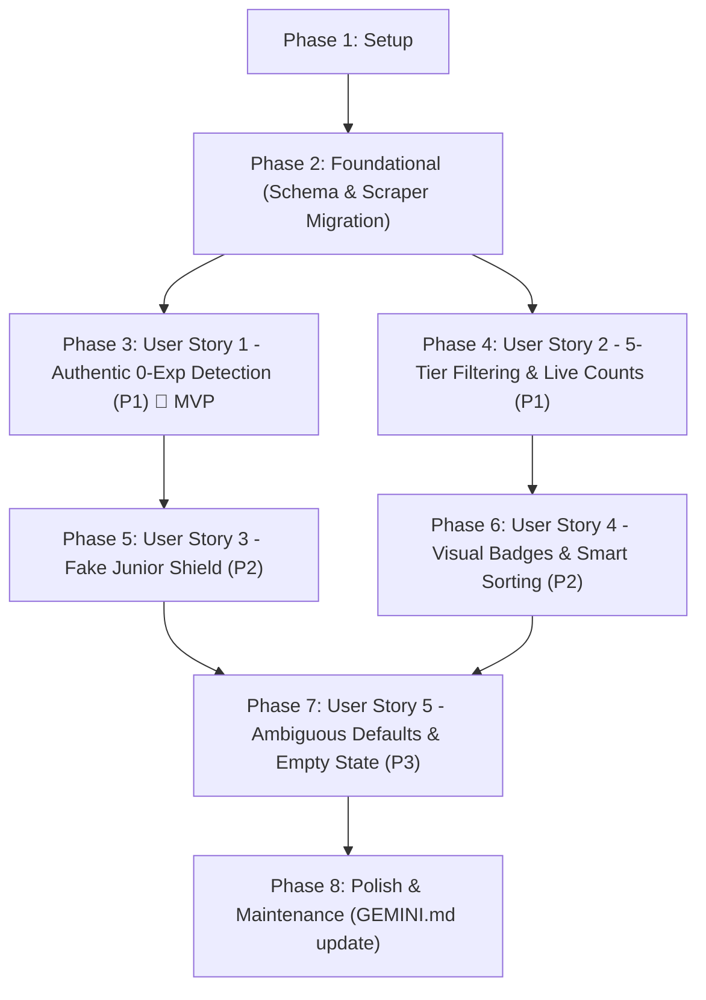

# Tasks: Smart Seniority Classification & "First REAL Job" Detection

**Input**: Design documents from `/specs/003-smart-seniority-classification/`  
**Prerequisites**: [plan.md](file:///Users/yairtejedahotmail.com/projects/mishooJobs/mishooJobs/specs/003-smart-seniority-classification/plan.md), [spec.md](file:///Users/yairtejedahotmail.com/projects/mishooJobs/mishooJobs/specs/003-smart-seniority-classification/spec.md), [data-model.md](file:///Users/yairtejedahotmail.com/projects/mishooJobs/mishooJobs/specs/003-smart-seniority-classification/data-model.md), [research.md](file:///Users/yairtejedahotmail.com/projects/mishooJobs/mishooJobs/specs/003-smart-seniority-classification/research.md), [contracts/api-contracts.md](file:///Users/yairtejedahotmail.com/projects/mishooJobs/mishooJobs/specs/003-smart-seniority-classification/contracts/api-contracts.md), [quickstart.md](file:///Users/yairtejedahotmail.com/projects/mishooJobs/mishooJobs/specs/003-smart-seniority-classification/quickstart.md)  
**Organization**: Tasks are grouped by user story to enable independent implementation and testing of each story.

---

## Format: `[ID] [P?] [Story] Description`

- **[P]**: Can run in parallel (different files, no dependencies on incomplete tasks)
- **[Story]**: Which user story this task belongs to (e.g., `[US1]`, `[US2]`, `[US3]`, `[US4]`, `[US5]`)
- Include exact file paths and quoted schema constraints in descriptions

---

## Phase 1: Setup (Shared Infrastructure)

**Purpose**: Prepare offline fixtures and verify development dependencies for seniority classification.

- [ ] T001 Configure offline test fixtures for seniority classification in `backend/tests/fixtures/seniority_fixtures.json`
- [ ] T002 [P] Verify backend and frontend dependencies (`curl_cffi`, `pydantic`, `pytest`, `vitest`) in `backend/pyproject.toml` and `frontend/package.json`

---

## Phase 2: Foundational (Blocking Prerequisites)

**Purpose**: Core schema migration, model definitions, DTO contracts, and scraper base updates that MUST be complete before ANY user story can be implemented.

**⚠️ CRITICAL**: No user story work can begin until this phase is complete.

- [ ] T003 Create Alembic migration `backend/alembic/versions/005_replace_category_with_seniority.py` creating enum `seniority_level_enum` (`'pasantia'`, `'primer_empleo'`, `'junior'`, `'mid'`, `'senior'`), enum `audit_status_enum` (`'preliminary'`, `'verified'`), adding columns `seniority_level` (`seniority_level_enum NOT NULL DEFAULT 'junior'`), `years_required_min` (`INTEGER NOT NULL DEFAULT 0, CHECK (years_required_min >= 0)`), `is_real_first_job` (`BOOLEAN NOT NULL DEFAULT FALSE`), `audit_status` (`audit_status_enum NOT NULL DEFAULT 'preliminary'`), `reasoning` (`TEXT NOT NULL DEFAULT ''`), `has_discrepancy` (`BOOLEAN NOT NULL DEFAULT FALSE`), adding indexes `ix_vacancies_seniority_level`, `ix_vacancies_is_real_first_job`, `ix_vacancies_audit_status`, and dropping column `category` and type `category_enum` from table `vacancies`
- [ ] T004 [P] Update `JobVacancy` model in `backend/src/mishoojobs/models/vacancy.py` to add `seniority_level`, `years_required_min`, `is_real_first_job`, `audit_status`, `reasoning`, `has_discrepancy`, and remove column `category`
- [ ] T005 [P] Update Pydantic DTOs in `backend/src/mishoojobs/schemas/job.py` defining `SeniorityLevelEnum` (`pasantia`, `primer_empleo`, `junior`, `mid`, `senior`), `SeniorityFilterEnum` (`all`, `pasantia`, `primer_empleo`, `junior`, `mid`, `senior`), `AuditStatusEnum` (`preliminary`, `verified`), updating `VacancyDTO` with `seniority_level: SeniorityLevelEnum = Field(default=SeniorityLevelEnum.JUNIOR)`, `years_required_min: int = Field(default=0, ge=0)`, `is_real_first_job: bool = Field(default=False)`, `audit_status: AuditStatusEnum = Field(default=AuditStatusEnum.PRELIMINARY)`, `reasoning: str = Field(default="")`, `has_discrepancy: bool = Field(default=False)` (removing legacy `category`), and updating `SearchParams` to replace `category` with `seniority: Optional[SeniorityFilterEnum] = SeniorityFilterEnum.ALL`
- [ ] T006 [P] Define `SeniorityAuditRequest` (`vacancy_fingerprint: Optional[str] = Field(default=None, max_length=64)`, `direct_url: Optional[str] = None`, `job_description: Optional[str] = None`) and `SeniorityAuditResponse` (`vacancy_fingerprint: str`, `seniority_level: SeniorityLevelEnum`, `years_required_min: int`, `is_real_first_job: bool`, `audit_status: AuditStatusEnum`, `reasoning: str`, `has_discrepancy: bool`, `is_cached: bool = False`, `audited_at: datetime`) in `backend/src/mishoojobs/schemas/evaluation.py`
- [ ] T007 [P] Update TypeScript interfaces in `frontend/src/types/job.ts` defining `SeniorityLevel` (`"pasantia" | "primer_empleo" | "junior" | "mid" | "senior"`), `SeniorityFilter` (`"all" | SeniorityLevel`), `AuditStatus` (`"preliminary" | "verified"`), `SeniorityTierOption`, `SeniorityCounts`, updating `JobVacancy` with new seniority attributes, and purging legacy `Category` / `category`
- [ ] T008 Implement Step 1 regex classifier `SeniorityClassifier.classify_fast(title: str, text: str)` in `backend/src/mishoojobs/services/seniority_classifier.py` for keyword and experience extraction, academic term parsing, and Spanish reasoning generation
- [ ] T009 Update `AbstractBaseScraper` in `backend/src/mishoojobs/services/scrapers/base.py` to integrate `SeniorityClassifier.classify_fast` and remove legacy `infer_category`
- [ ] T010 [P] Update portal scrapers in `backend/src/mishoojobs/services/scrapers/computrabajo.py`, `backend/src/mishoojobs/services/scrapers/indeed.py`, and `backend/src/mishoojobs/services/scrapers/occ.py` to populate seniority attributes and remove `category`
- [ ] T011 Update `backend/src/mishoojobs/api/routes/jobs.py` and `backend/src/mishoojobs/api/sse.py` to replace `category` query parameter with `seniority`, filter stream batches, and preserve existing `audit_status == 'verified'` on PostgreSQL upsert

**Checkpoint**: Foundation ready - all core entities, schemas, scrapers, and SSE stream endpoints have purged `category` and support `seniority_level` and `audit_status`.

---

## Phase 3: User Story 1 - Authentic "First REAL Job" (0 Exp) Discovery & Verification (Priority: P1) 🎯 MVP

**Goal**: Discover and verify authentic formal paid employment offers requiring strictly 0 years of commercial work experience, with Step 2 deep AI audit via `agy` CLI, permanent PostgreSQL caching by fingerprint hash, and Anti-Scam Shield qualification.

**Independent Test**: Conduct a search (e.g., "Frontend Developer" or "Python Junior") and click the "Primer Empleo Real (0 Exp)" filter pill. Inspect each displayed card to verify that it displays the high-contrast emerald `[ PRIMER EMPLEO REAL ]` badge, requires strictly 0 years of prior commercial work experience, represents formal paid employment, and excludes any position demanding 1 or more years of verifiable experience.

### Tests for User Story 1 ⚠️

- [ ] T012 [P] [US1] Unit tests for 0-experience classification and verified status logic in `backend/tests/unit/test_seniority_classifier.py`
- [ ] T013 [P] [US1] Integration tests for Step 2 Deep Audit API and PostgreSQL caching in `backend/tests/integration/test_seniority_audit_api.py`

### Implementation for User Story 1

- [ ] T014 [US1] Implement `run_seniority_audit` in `backend/src/mishoojobs/services/agy_ai_client.py` using local `agy` CLI subprocess execution and strict JSON parsing
- [ ] T015 [US1] Implement `POST /api/v1/vacancies/{fingerprint}/audit` endpoint in `backend/src/mishoojobs/api/routes/vacancies.py` with multi-portal full description enrichment, PostgreSQL cache check, and verified status persistence
- [ ] T016 [US1] Update `POST /api/v1/vacancies/evaluate` in `backend/src/mishoojobs/api/routes/vacancies.py` and `backend/src/mishoojobs/services/agy_ai_client.py` to embed `seniority_audit` metadata in `AIEvaluationResponse`
- [ ] T017 [P] [US1] Add `auditVacancy(fingerprint: string, directUrl?: string, jobDescription?: string)` client method in `frontend/src/services/api.ts` passing `{ vacancy_fingerprint: fingerprint, direct_url: directUrl, job_description: jobDescription }` to `POST /api/v1/vacancies/${encodeURIComponent(fingerprint)}/audit`
- [ ] T018 [US1] Update `frontend/src/components/VacancyDetailModal.tsx` to trigger on-demand `auditVacancy` when `audit_status === 'preliminary'`, displaying loading state, verified badge, and reasoning

**Checkpoint**: At this point, User Story 1 (MVP) is fully functional and testable independently: authentic 0-experience positions can be classified via Step 1 fast-pass and deeply verified via Step 2 AI audit with PostgreSQL caching.

---

## Phase 4: User Story 2 - Streamlined 5-Tier Experience Filtering with Real-Time Counts (Priority: P1)

**Goal**: Replace legacy category filters with 5 standardized experience tiers (`pasantia`, `primer_empleo`, `junior`, `mid`, `senior`) plus "Todos los niveles", displaying real-time vacancy counters, instant (<100ms) client-side filtering, and URL query synchronization (`?seniority=<tier>`).

**Independent Test**: Open the filter controls, observe live vacancy count badges next to each of the 5 tiers plus "Todos los niveles", select different tiers (e.g., "Junior (1–2 años)" then "Pasantía / Prácticas"), and verify that results update immediately, active search terms and location are preserved, and pagination resets to page 1.

### Tests for User Story 2 ⚠️

- [ ] T019 [P] [US2] Component tests for 5-tier filter controls and live counters in `frontend/tests/components/FilterDrawer.test.tsx`
- [ ] T020 [P] [US2] Unit and hook tests for URL synchronization (`?seniority=<tier>`) and browser history navigation in `frontend/tests/hooks/useJobStream.test.ts`

### Implementation for User Story 2

- [ ] T021 [US2] Update SSE client service in `frontend/src/services/sse.ts` and `frontend/src/hooks/useJobStream.ts` to replace `category` query parameter with `seniority: SeniorityFilter`
- [ ] T022 [US2] Update `frontend/src/App.tsx` state management to replace `category` with `seniority`, synchronize with URL query `?seniority=<value>`, compute dynamic `tierCounts` for all 6 options from deduplicated vacancy pool, and handle browser navigation history
- [ ] T023 [US2] Update `frontend/src/components/FilterDrawer.tsx` to render the 5 mutually exclusive experience tiers plus "Todos los niveles" with live vacancy counters, single-select toggles, and keyboard navigation
- [ ] T024 [US2] Update quick filter pills in `frontend/src/components/VacancyList.tsx` to display horizontal filter pills with real-time counters and high-intent styling on "Primer Empleo Real"

**Checkpoint**: User Stories 1 AND 2 both work independently. Candidates can filter across the 5 experience tiers with real-time counters, instant UI response, and shareable URL query parameters.

---

## Phase 5: User Story 3 - "Fake Junior" Shield & Visual Discrepancy Indicators (Priority: P2)

**Goal**: Automatically flag and reclassify deceptive postings whose titles claim entry-level status ("Becario", "Junior", "Trainee") but whose body requirements demand 2 or more years of commercial experience, preventing them from contaminating entry-level feeds and displaying discrepancy tags.

**Independent Test**: Find or supply a job listing titled "Junior React Developer" that requires "3 años de experiencia en proyectos reales". Verify that the system reclassifies its experience tier to "Mid" and displays a visible discrepancy warning tag explaining that the actual requirements exceed entry-level expectations.

### Tests for User Story 3 ⚠️

- [ ] T025 [P] [US3] Unit tests for "Fake Junior" discrepancy detection and reclassification in `backend/tests/unit/test_seniority_classifier.py`
- [ ] T026 [P] [US3] Component tests for discrepancy warning badge rendering in `frontend/tests/components/VacancyCard.test.tsx`

### Implementation for User Story 3

- [ ] T027 [US3] Enhance `SeniorityClassifier` in `backend/src/mishoojobs/services/seniority_classifier.py` with regex rules detecting title-vs-requirement discrepancies (title matches junior/intern tokens while requirements text specifies $\ge 2$ years $\rightarrow$ reclassify to `mid`/`senior`, set `has_discrepancy = True`)
- [ ] T028 [US3] Update `AgyAIClient.run_seniority_audit` prompt in `backend/src/mishoojobs/services/agy_ai_client.py` to evaluate and explain title-vs-requirement discrepancies
- [ ] T029 [US3] Update `frontend/src/components/VacancyCard.tsx` and `frontend/src/components/VacancyDetailModal.tsx` to render amber `[ REQUISITOS DISCREPANTES ]` badge and discrepancy reasoning

**Checkpoint**: User Stories 1, 2, and 3 are functional. "Fake Junior" postings are quarantined to Mid/Senior and clearly flagged with warning tags.

---

## Phase 6: User Story 4 - Visual Seniority Badges & Default Sorting for First Jobs (Priority: P2)

**Goal**: Render standardized, color-coded seniority badges on all vacancy cards and implement smart default sorting when filtering by "Primer Empleo Real" (verified 0-exp first, then preliminary, by recency), while preserving user sort overrides.

**Independent Test**: View a mixed list of vacancies across different seniority tiers and verify that each card renders its respective color-coded badge. Activate the "Primer Empleo Real" filter and verify that vacancies with explicit zero-experience guarantees and comprehensive onboarding appear at the top.

### Tests for User Story 4 ⚠️

- [ ] T030 [P] [US4] Component tests for standardized color-coded seniority badges and verified indicators in `frontend/tests/components/VacancyCard.test.tsx`
- [ ] T031 [P] [US4] Unit tests for verified-first default sorting in `frontend/tests/components/VacancyList.test.tsx`

### Implementation for User Story 4

- [ ] T032 [US4] Update `frontend/src/components/VacancyCard.tsx` to render color-coded seniority badges (`[ PASANTÍA ]` in cyan, `[ PRIMER EMPLEO REAL ]` in emerald, `[ JR ]` in violet, `[ MID ]` in amber, `[ SR ]` in rose/red) and verified vs preliminary indicators
- [ ] T033 [US4] Update heuristic fit scorers in `frontend/src/services/heuristic_scorer.ts` and `backend/src/mishoojobs/services/heuristic_scorer.py` to migrate from legacy `category` to `seniority_level` (awarding full fit weight for `primer_empleo` and `junior`, neutral for `pasantia`, and score penalties for `mid` and `senior`)
- [ ] T034 [US4] Implement smart default sorting in `frontend/src/App.tsx` and `frontend/src/components/VacancyList.tsx` when filtering by `primer_empleo` (verified first, then preliminary, by publication date) while respecting user sort overrides

**Checkpoint**: Standardized badges rendered on all cards, emerald highlight for 0-exp, and verified-first default ordering operational.

---

## Phase 7: User Story 5 - Handling Ambiguous Requirements & Helpful Empty State (Priority: P3)

**Goal**: Intelligently default ambiguous postings lacking numerical years to `junior` (`preliminary`), enforce Anti-Scam Shield disqualification of unpaid/fraudulent offers from "Primer Empleo Real", provide a helpful empty state with one-click recovery, and handle graceful URL fallbacks.

**Independent Test**: Conduct a search where a posting lacks numerical years of experience, confirming it receives an audited tier based on responsibilities and mentorship mentions. Filter by a tier with 0 matches and verify that an empty state appears with suggestions to expand to "Pasantía" or "Junior" along with a one-click reset button.

### Tests for User Story 5 ⚠️

- [ ] T035 [P] [US5] Unit tests for ambiguous requirement defaulting and Anti-Scam Shield disqualification in `backend/tests/unit/test_seniority_classifier.py` and `backend/tests/unit/test_scam_detector.py`
- [ ] T036 [P] [US5] Component tests for empty state recovery card and URL fallback in `frontend/tests/components/VacancyList.test.tsx`

### Implementation for User Story 5

- [ ] T037 [US5] Update `SeniorityClassifier` in `backend/src/mishoojobs/services/seniority_classifier.py` and `backend/src/mishoojobs/services/scam_detector.py` to default neutral descriptions to `junior` (`preliminary`) and disqualify unpaid/scam postings from `is_real_first_job = True`
- [ ] T038 [US5] Implement dedicated empty state in `frontend/src/components/VacancyList.tsx` when active seniority filter has 0 matches, suggesting expansion to Pasantía or Junior and providing a "Limpiar filtro de experiencia" button
- [ ] T039 [US5] Update URL parameter validation in `frontend/src/App.tsx` to gracefully fall back to `"all"` when an unrecognized seniority value is provided in `?seniority=`

**Checkpoint**: All 5 user stories are completely implemented and robust against real-world edge cases.

---

## Phase 8: Polish & Cross-Cutting Concerns

**Purpose**: Offline test execution, cleanups, quickstart validation, and mandatory project constitution updates.

- [ ] T040 [P] Verify 100% offline backend test execution across unit and integration suites with `.venv/bin/pytest backend/tests/ -v`
- [ ] T041 [P] Verify 100% frontend test execution with `npm test -- --run` in `frontend/`
- [ ] T042 Verify end-to-end scenarios from `specs/003-smart-seniority-classification/quickstart.md`
- [ ] T043 Code cleanup and verification of full-stack purge of legacy `category` across backend and frontend
- [ ] T044 [P] Update documentation in `backend/README.md` reflecting `seniority_level` and new endpoints
- [ ] T045 Update `GEMINI.md` with key design decisions and new conventions established by feature 003:
  - `[003] Full-stack purge of legacy category in favor of unified 5-tier seniority_level (pasantia, primer_empleo, junior, mid, senior)`
  - `[003] Two-step hybrid seniority classification: deterministic fast-pass in live SSE stream and on-demand agy CLI deep audit in vacancy modal`
  - `[003] High-contrast emerald badge and verified-first default sorting for authentic 0-experience Primer Empleo Real listings`
  - `[003] Deceptive Fake Junior shield automatically reclassifying 2+ year requirements to Mid/Senior with discrepancy warning tags`

---

## Dependencies & Execution Order

### Phase Dependencies

- **Setup (Phase 1)**: No dependencies - can start immediately
- **Foundational (Phase 2)**: Depends on Setup completion - BLOCKS all user stories
- **User Stories (Phase 3+)**: All depend on Foundational phase completion
  - User Story 1 (P1) and User Story 2 (P1) can proceed in parallel once Phase 2 is complete
  - User Story 3 (P2) depends on SeniorityClassifier from Phase 2
  - User Story 4 (P2) depends on VacancyCard badges from US1/US2
  - User Story 5 (P3) depends on VacancyList filtering from US2
- **Polish (Phase 8)**: Depends on all desired user stories being complete

### User Story Completion Order



---

## Parallel Execution Opportunities

### Phase 2: Foundational
```bash
# Launch models, DTOs, and TypeScript interfaces together:
Task T004: "Update JobVacancy model in backend/src/mishoojobs/models/vacancy.py"
Task T005: "Update Pydantic DTOs in backend/src/mishoojobs/schemas/job.py"
Task T006: "Define SeniorityAuditRequest and SeniorityAuditResponse in backend/src/mishoojobs/schemas/evaluation.py"
Task T007: "Update TypeScript interfaces in frontend/src/types/job.ts"

# Launch scraper updates across portals together:
Task T010: "Update portal scrapers in computrabajo.py, indeed.py, occ.py"
```

### Phase 3: User Story 1
```bash
# Launch test suite tasks in parallel:
Task T012: "Unit tests in backend/tests/unit/test_seniority_classifier.py"
Task T013: "Integration tests in backend/tests/integration/test_seniority_audit_api.py"
Task T017: "Add auditVacancy client method in frontend/src/services/api.ts"
```

### Phase 4: User Story 2
```bash
# Launch frontend tests in parallel:
Task T019: "Component tests in frontend/tests/components/FilterDrawer.test.tsx"
Task T020: "Unit and hook tests in frontend/tests/hooks/useJobStream.test.ts"
```

---

## Implementation Strategy

### MVP First (User Story 1 Only)

1. Complete **Phase 1: Setup**
2. Complete **Phase 2: Foundational** (CRITICAL - blocks all stories)
3. Complete **Phase 3: User Story 1**
4. **STOP and VALIDATE**: Run `backend/tests/unit/test_seniority_classifier.py` and `backend/tests/integration/test_seniority_audit_api.py` to confirm authentic 0-experience detection and Step 2 deep audit work independently.
5. Deploy/demo MVP increment.

### Incremental Delivery

1. Setup + Foundational $\rightarrow$ Foundation ready with full-stack `seniority_level` purge of `category`
2. Add User Story 1 $\rightarrow$ Authentic 0-exp detection & Step 2 deep AI audit (MVP!)
3. Add User Story 2 $\rightarrow$ 5-tier filter controls with real-time counters & URL sync
4. Add User Story 3 $\rightarrow$ Fake Junior discrepancy quarantine & warning tags
5. Add User Story 4 $\rightarrow$ Standardized color-coded badges & smart default sorting
6. Add User Story 5 $\rightarrow$ Ambiguous defaults & helpful empty state recovery
7. Polish $\rightarrow$ Offline test suite validation and `GEMINI.md` convention update

---

## Notes

- All tasks use strict checklist format `- [ ] [TaskID] [P?] [Story?] Description with file path`
- Every file path is exact and relative to repository root
- Schema field constraints from `data-model.md` are quoted verbatim in Phase 2 tasks
- Offline deterministic tests run without live network calls or paid external APIs
- Step 2 Deep Audit strictly delegates to local Antigravity CLI (`agy`) with PostgreSQL composite fingerprint caching
