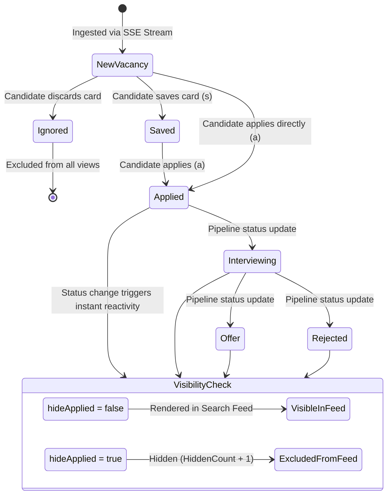

# Data Model: Hide Applied Vacancies & Search Feed Clean-Up

**Feature**: `004-hide-applied-vacancies`  
**Date**: 2026-11-08  
**Scope**: Frontend client-side state models, Dexie.js entity schemas, localStorage preference contracts, and vacancy visibility state transitions.

---

## 1. Entities & Types

### 1.1 ApplicationStatus (Extended)

Enumeration of candidate interaction states tracked in browser `IndexedDB`.

```typescript
export type ApplicationStatus =
  | "new"           // Untracked / pristine vacancy
  | "saved"         // Saved to pipeline for future review (retained in feed)
  | "applied"       // Candidate submitted application (hidden when toggle active)
  | "interviewing"  // Recruiter screening or interview in progress (hidden)
  | "rejected"      // Candidate rejected by employer (hidden)
  | "offer"         // Job offer received (hidden)
  | "ignored";      // Discarded by candidate (hidden globally across all views)
```

#### Status Categorization Matrix
| Status | Pipeline Category | Kept in Feed When `hideApplied = false` | Kept in Feed When `hideApplied = true` |
|---|---|---|---|
| `new` | Pristine | ✅ Yes | ✅ Yes |
| `saved` | Pre-Application | ✅ Yes | ✅ Yes |
| `applied` | Post-Application | ✅ Yes | ❌ **Excluded (Hidden)** |
| `interviewing` | Post-Application | ✅ Yes | ❌ **Excluded (Hidden)** |
| `rejected` | Post-Application | ✅ Yes | ❌ **Excluded (Hidden)** |
| `offer` | Post-Application | ✅ Yes | ❌ **Excluded (Hidden)** |
| `ignored` | Discarded | ❌ **Excluded Globally** | ❌ **Excluded Globally** |

---

### 1.2 ApplicationRecord

Schema of the candidate application record stored in IndexedDB (`mishoojobs_local_db.applications`).

```typescript
export interface ApplicationRecord {
  /** Canonical composite SHA-256 fingerprint of the vacancy */
  vacancy_fingerprint: string;

  /** Normalized job title */
  title: string;

  /** Employer or agency name */
  company_name: string;

  /** Current candidate workflow state */
  status: ApplicationStatus;

  /** Primary direct external application URL */
  direct_url: string;

  /** Cached heuristic fit score (0 - 100) if active profile was evaluated */
  fit_score?: number;

  /** Candidate personal notes */
  notes?: string;

  /** UTC ISO 8601 timestamp of application submission */
  applied_at?: string | null;

  /** UTC ISO 8601 timestamp of last status modification */
  updated_at: string;
}
```

**Dexie Schema Index**: `applications: "vacancy_fingerprint, status, updated_at"`

---

### 1.3 AppliedFilterPreference

Contract for persisting user toggle state in browser `localStorage`.

```typescript
export interface AppliedFilterPreference {
  /** Local storage key */
  key: "mishoojobs_hide_applied";

  /** Persisted value */
  value: boolean;
}
```

- **Storage Target**: `window.localStorage`
- **Default Value**: `false` (shows all vacancies on initial visit)
- **Serialization**: `JSON.stringify(boolean)` / `"true"` or `"false"`
- **URL Query Inclusion**: **Strictly Prohibited** (zero sync with `window.location.search`)

---

### 1.4 FeedVisibilityMetrics

Contextual visibility and badge count metrics for the active search session.

```typescript
export interface FeedVisibilityMetrics {
  /** Total verified unique vacancies before status filtering */
  totalUnignored: number;

  /** Total vacancies currently visible and rendered in VacancyList */
  visibleCount: number;

  /** Count of applied vacancies excluded by hideApplied filter in current scope */
  hiddenCount: number;

  /** Whether the hide-applied toggle is currently enabled */
  isHideApplied: boolean;

  /** Whether all matching vacancies have been applied to (100% applied condition) */
  isAllAppliedEmptyState: boolean;
}
```

---

## 2. State Transitions & Visibility Pipeline



### 2.1 State Transition Invariants
1. **Immediate In-Flight Collapse**: When `hideApplied = true` and vacancy status transitions to `applied`, the vacancy is instantly removed from `displayedVacancies` without full component remount.
2. **Reversible Toggle**: Toggling `hideApplied` from `true` to `false` restores all hidden vacancies to their exact previous sorted positions without network requests.
3. **Empty State Determinism**:
   - If `visibleCount === 0 && hiddenCount > 0 && isHideApplied`: Render **100% Applied Empty State**.
   - If `visibleCount === 0 && (hiddenCount === 0 || !isHideApplied)`: Render **Standard Filter/Search Empty State**.
