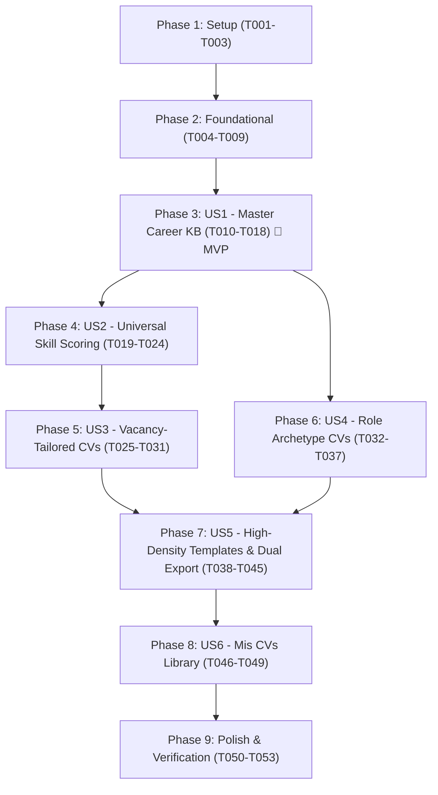

# Tasks: Master Career Knowledge Base & Dynamic AI CV Generator

**Input**: Design documents from `/specs/005-master-profile-cv/`  
**Prerequisites**: [plan.md](file:///Users/yairtejedahotmail.com/projects/mishooJobs/mishooJobs/specs/005-master-profile-cv/plan.md), [spec.md](file:///Users/yairtejedahotmail.com/projects/mishooJobs/mishooJobs/specs/005-master-profile-cv/spec.md), [research.md](file:///Users/yairtejedahotmail.com/projects/mishooJobs/mishooJobs/specs/005-master-profile-cv/research.md), [data-model.md](file:///Users/yairtejedahotmail.com/projects/mishooJobs/mishooJobs/specs/005-master-profile-cv/data-model.md), [contracts/](file:///Users/yairtejedahotmail.com/projects/mishooJobs/mishooJobs/specs/005-master-profile-cv/contracts/)

## Format: `[ID] [P?] [Story] Description`

- **[P]**: Can run in parallel (different files, no dependencies)
- **[Story]**: Which user story this task belongs to (e.g., US1, US2, US3, US4, US5, US6)
- Exact file paths included in every task description

---

## Phase 1: Setup (Shared Infrastructure)

**Purpose**: Dependency installation, package manifests, and offline mock fixtures.

- [X] T001 Add `pypdf>=5.1.0`, `pyyaml>=6.0.2`, and `python-multipart>=0.0.12` to `backend/pyproject.toml` and install into backend virtual environment
- [X] T002 [P] Add `yaml` (v2.7+) to `frontend/package.json` dependencies and install into `frontend/node_modules/`
- [X] T003 [P] Create deterministic offline test fixtures `sample_master_profile.yml` and `sample_resume.md` in `backend/tests/fixtures/`

---

## Phase 2: Foundational (Blocking Prerequisites)

**Purpose**: Core client storage schemas, Pydantic validation DTOs, TypeScript domain models, and API router scaffolding.

**⚠️ CRITICAL**: No user story implementation can begin until this foundational phase is complete.

- [X] T004 Upgrade Dexie database schema to version 2 in `frontend/src/db/index.ts` declaring stores `master_profile: "id, updated_at"`, `master_profile_photo: "id"`, and `resumes: "id, type, target_role, vacancy_fingerprint, created_at, updated_at"` while retaining legacy version 1 stores
- [X] T005 [P] Define TypeScript domain models in `frontend/src/types/master_profile.ts` with strict types: `PersonalInfo` (`full_name`: string, `headline`: string, `email`: string, `phone`: string, `location`: string, `website`?: string, `github`?: string, `linkedin`?: string, `photo`: boolean), `CategorizedTechStack` (`backend`: string[], `frontend`: string[], `databases`: string[], `messaging_distributed`: string[], `ai_data`: string[], `devops_cloud`: string[], `tools`: string[]), `LanguageItem` (`language`: string, `level`: string), `ExperienceItem` (`company`: string, `role`: string, `location`?: string, `start_date`: string, `end_date`: string, `current`: boolean, `highlights`: string[]), `ProjectItem` (`name`: string, `description`: string, `technologies`: string[], `link`?: string, `highlights`: string[]), `EducationItem` (`institution`: string, `degree`: string, `field`: string, `start_date`: string, `end_date`: string, `gpa`?: string, `current`: boolean), `CertificateItem` (`name`: string, `issuer`: string, `issue_date`: string, `expiry_date`?: string, `credential_id`?: string, `url`?: string), `LogroAcademicoItem` (`title`: string, `organization`: string, `date`: string, `description`: string), and canonical `MasterProfileData`
- [X] T006 [P] Define TypeScript domain models in `frontend/src/types/resume.ts` for `TemplateId` (`"technical_high_density" | "classic_ats" | "modern_executive"`), `GeneratedResumeRecord` (`id`: string, `type`: `"vacancy" | "role_archetype"`, `title`: string, `target_role`: string, `language`: `"es" | "en"`, `vacancy_fingerprint`?: string, `vacancy_company`?: string, `vacancy_title`?: string, `template_id`: TemplateId, `photo_enabled`: boolean, `content`: GeneratedCVContent, `ats_match_score`?: number, `revision`: number, `created_at`: string, `updated_at`: string), and `GeneratedCVContent`
- [X] T007 [P] Define Pydantic v2 schemas in `backend/src/mishoojobs/schemas/master_profile.py` matching canonical JSON schema constraints: `PersonalInfoSchema`, `CategorizedTechStackSchema`, `LanguageItemSchema`, `ExperienceItemSchema`, `ProjectItemSchema`, `EducationItemSchema`, `CertificateItemSchema`, `LogroAcademicoItemSchema`, and root `MasterProfileSchema`
- [X] T008 [P] Define Pydantic v2 request/response DTOs in `backend/src/mishoojobs/schemas/resume.py`: `ParseResumeResponse` (`yaml_content`: str, `warnings`: list[str]), `GenerateTailoredCVRequest` (`master_profile`: dict, `vacancy_title`: str, `vacancy_company`: str, `job_description`: str, `desired_skills`: list[str] = [], `language`: str = "es"), `GenerateRoleCVRequest` (`master_profile`: dict, `target_role_title`: str, `focus_tags`: list[str] = [], `language`: str = "es"), `GenerateCVResponse` (`content`: dict, `ats_match_score`: int, `word_count`: int, `curation_notes`: str | None = None), and `ErrorResponse` (`detail`: str)
- [X] T009 Create FastAPI router in `backend/src/mishoojobs/api/routes/cv.py` and register router under prefix `/cv` with tag `cv` in `backend/src/mishoojobs/api/main.py`

**Checkpoint**: Foundation ready - storage schemas, data contracts, and router registration are in place.

---

## Phase 3: User Story 1 - Master Career Knowledge Base Ingestion & Structured Management (Priority: P1) 🎯 MVP

**Goal**: Candidates can upload existing resumes (YAML, PDF, Markdown) or edit structured YAML directly in-browser to bootstrap their Master Career Knowledge Base, with real-time syntax validation (emerald/rose badges), destructive overwrite warning, isolated photo Blob storage, and 100% client-side persistence in IndexedDB (`master_profile` and `master_profile_photo`).

**Independent Test**: Upload a structured `.yml` file (or PDF/Markdown resume). Verify that the system parses and loads the content into the in-browser YAML editor with line numbers, validates syntax in real time, displays an emerald badge when valid or rose badge when invalid, disables saving while invalid, saves permanently to Dexie `master_profile` on valid save, persists photo binaries to `master_profile_photo`, and survives page reloads with zero backend database storage.

### Tests for User Story 1

- [X] T010 [P] [US1] Create backend unit and contract tests in `backend/tests/test_cv_service.py` verifying `POST /cv/parse-resume` with PDF, Markdown, and YAML fixtures, testing in-memory extraction, `agy` CLI structuring, canonical YAML output, and zero database persistence
- [X] T011 [P] [US1] Create frontend unit tests in `frontend/tests/services/master_profile_service.test.ts` verifying YAML parsing, line/column AST syntax error reporting, starter template generation, and Dexie `master_profile` persistence

### Implementation for User Story 1

- [X] T012 [US1] Implement `parse_resume_to_yaml` method in `backend/src/mishoojobs/services/agy_ai_client.py` orchestrating local `agy` CLI subprocess to map raw text into canonical `MasterProfileSchema` JSON and format to clean YAML with `pyyaml`
- [X] T013 [US1] Implement ephemeral stateless endpoint `POST /cv/parse-resume` in `backend/src/mishoojobs/api/routes/cv.py` ingesting `multipart/form-data` file (.pdf via `pypdf.PdfReader`, .md/.txt/.yml via UTF-8 decode), delegating to `parse_resume_to_yaml`, and returning `ParseResumeResponse` with zero server storage or disk caching
- [X] T014 [US1] Implement `frontend/src/services/master_profile_service.ts` providing `parseAndValidateYAML` using `yaml` npm package with line-level error detection, `getMasterProfileStarterTemplate` with Mexican early-career defaults, `saveMasterProfile`, `loadMasterProfile`, and `exportMasterProfileYAML` (downloading raw YAML as a `.yml` file blob) Dexie operations
- [X] T015 [P] [US1] Implement `AvatarUploader.tsx` in `frontend/src/components/AvatarUploader.tsx` supporting image file selection, client-side off-screen HTML5 `<canvas>` resizing to max 512x512 (WEBP/JPEG), storage quota check (warning if usage >80% via `navigator.storage.estimate()`), image preview, and isolated Blob persistence in Dexie `master_profile_photo` table
- [X] T016 [US1] Implement `MasterProfileEditor.tsx` in `frontend/src/components/MasterProfileEditor.tsx` with Geist Mono textarea, dynamic line number gutter, real-time syntax status badge (`[ESTRUCTURA VÁLIDA]` in emerald vs `[ERROR EN LÍNEA X: ...]` in rose), disabled save guard, file upload trigger (YAML, PDF, Markdown) with destructive overwrite confirmation modal, "Descargar YAML" export action button triggering `exportMasterProfileYAML`, and `AvatarUploader` integration
- [X] T017 [US1] Add "Perfil Maestro" navigation button and editor modal container in `frontend/src/components/Header.tsx` and integrate state management into `frontend/src/App.tsx`
- [X] T018 [P] [US1] Create component tests in `frontend/tests/components/MasterProfileEditor.test.tsx` verifying syntax validation badge toggling, destructive upload confirmation dialog, and IndexedDB saving

**Checkpoint**: At this point, User Story 1 delivers an independent MVP: a complete, privacy-first Master Career Knowledge Base editor and file ingestion pipeline running entirely in local browser storage.

---

## Phase 4: User Story 2 - Universal Platform Skills Synchronization & Fit Scoring (Priority: P1)

**Goal**: Curated technical skills from the Master Profile (`tech.backend`, `tech.frontend`, `tech.databases`, `tech.messaging_distributed`, `tech.ai_data`, `tech.devops_cloud`, `tech.tools`, and `projects.technologies`) serve as the canonical single source of truth across the platform, immediately driving job search card heuristic match scores and deep AI fit evaluations, cleanly deprecating the legacy regex parser.

**Independent Test**: Add new technical skills (e.g., "FastAPI", "PostgreSQL", "Kafka") under `tech` in the Master Profile and save. Return to the job search feed and verify that vacancies requiring those skills immediately reflect updated compatibility percentages and match badges, and deep AI evaluation incorporates them without page reload.

### Tests for User Story 2

- [X] T019 [P] [US2] Create unit tests in `frontend/tests/services/master_profile_skills.test.ts` verifying extraction, normalization (lowercase, trimmed), and deduplication of skills from `MasterProfileData` across all categorized tech domains and project technologies

### Implementation for User Story 2

- [X] T020 [US2] Implement `frontend/src/services/master_profile_skills.ts` with `extractMasterProfileSkills(profile: MasterProfileData): string[]` extracting and normalizing unique skills across all 7 tech categories and project items
- [X] T021 [US2] Refactor `frontend/src/services/heuristic_scorer.ts` to compute match percentages and matching skill badges directly against normalized Master Profile skills, deprecating `frontend/src/services/resume_parser.ts`
- [X] T022 [US2] Create reactive hook `frontend/src/hooks/useMasterProfile.ts` using Dexie `useLiveQuery` to expose the active Master Profile, photo Blob URL, and universal skills array to components
- [X] T023 [US2] Update `frontend/src/components/VacancyCard.tsx` and `frontend/src/components/VacancyDetailModal.tsx` to consume universal skills from `useMasterProfile`, instantly updating heuristic match scores, match badges, and evaluation payload
- [X] T024 [US2] Verify and adjust `backend/src/mishoojobs/api/routes/vacancies.py` and `AgyAIClient.evaluate_match` to ensure AI evaluation requests accept and process the comprehensive Master Profile skills and background without schema conflicts

**Checkpoint**: User Stories 1 and 2 operate in unison: editing skills in the Master Profile immediately propagates live compatibility scoring and AI evaluations across the entire vacancy feed.

---

## Phase 5: User Story 3 - One-Click Vacancy-Tailored CV Generation (Priority: P1)

**Goal**: From any vacancy detail view, candidates can generate an ATS-optimized, 1-page CV tailored specifically to that job posting, with an interactive ES/EN language toggle (defaulting to Spanish), STAR-rephrased bullets, anti-hallucination fact shield, max 500 words limit, auto-saving to Dexie `resumes` and opening in the Live CV Viewer.

**Independent Test**: Open a job vacancy, click "Generar CV Adaptado", toggle language between ES and EN (leave ES), click generate. Verify that the backend curates 2-4 relevant experiences and 2-3 projects, rephrases bullets into STAR action-verb statements without hallucinating unlisted metrics/dates, adheres to the 500-word budget, saves to Dexie `resumes` table with `type: "vacancy"` and `vacancy_fingerprint`, and displays in viewer.

### Tests for User Story 3

- [X] T025 [P] [US3] Create backend unit and contract tests in `backend/tests/test_cv_service.py` for `POST /cv/generate-tailored` testing STAR formatting, anti-hallucination fact shield verification, 500-word limit validation, and HTTP 422 rejection on incomplete profile (<1 experience/project or <2 skills)

### Implementation for User Story 3

- [X] T026 [US3] Implement `generate_tailored_cv` method in `backend/src/mishoojobs/services/agy_ai_client.py` orchestrating `agy` CLI with prompt rules: enforce STAR method (Action verb + Situation/Task + Result), strict anti-hallucination fact shield prohibiting unlisted dates/metrics/technologies, max 500 words limit, select top 2-4 experiences and 2-3 projects, and localize to target language (`es` default, `en` optional)
- [X] T027 [US3] Implement endpoint `POST /cv/generate-tailored` in `backend/src/mishoojobs/api/routes/cv.py` validating profile completeness (>=1 experience/project and >=2 skills; raising HTTP 422 if incomplete) and delegating to `generate_tailored_cv` to return `GenerateCVResponse`
- [X] T028 [P] [US3] Implement API client method `generateTailoredCV` in `frontend/src/services/cv_api.ts` calling `POST /cv/generate-tailored` with error handling
- [X] T029 [US3] Implement `VacancyTailorModal.tsx` in `frontend/src/components/VacancyTailorModal.tsx` displaying target vacancy metadata (title, company, required skills), interactive language toggle (ES / EN), profile completeness check (halting with guidance if <1 exp/project or <2 skills), revision auto-increment (checking existing `vacancy_fingerprint` in Dexie `resumes` to set `revision = existingCount + 1`), loading indicator, and saving generated resume to Dexie `resumes` table
- [X] T030 [US3] Add "Generar CV Adaptado" action button to `frontend/src/components/VacancyDetailModal.tsx` triggering `VacancyTailorModal` and transitioning to the Live CV Viewer upon generation completion
- [X] T031 [P] [US3] Create component tests in `frontend/tests/components/VacancyTailorModal.test.tsx` verifying language toggle, profile validation guard, and Dexie resume persistence

**Checkpoint**: Vacancy-tailored CV generation is fully operational and automatically stored in the candidate's browser storage.

---

## Phase 6: User Story 4 - Role Archetype Baseline CV Generation (Priority: P2)

**Goal**: Candidates can generate evergreen archetype resumes for general career tracks (e.g., "AI Engineer", "Frontend Developer") without a specific vacancy link, specifying role title, focus tags, and language (ES/EN), saved to Dexie `resumes` with `type: "role_archetype"` and distinct role badges.

**Independent Test**: Open the role archetype creation dialog, enter target role "AI Engineer" and focus tags "Python, PyTorch, LLMs, FastAPI", select Spanish, click generate. Verify that the resume curates AI/data skills and machine learning projects from the Master Profile, limits word count to 500, saves to Dexie `resumes` with `type: "role_archetype"`, and tags with `[ROL: AI Engineer]`.

### Tests for User Story 4

- [X] T032 [P] [US4] Create backend unit and contract tests in `backend/tests/test_cv_service.py` for `POST /cv/generate-role` testing role title curation, focus tag prioritization, anti-hallucination compliance, and HTTP 422 rejection on incomplete profile

### Implementation for User Story 4

- [X] T033 [US4] Implement `generate_role_cv` method in `backend/src/mishoojobs/services/agy_ai_client.py` orchestrating `agy` CLI to balance and curate Master Profile data towards target role title and focus tags, enforcing STAR bullets, anti-hallucination fact shield, max 500 words limit, and language localization (`es` default, `en` optional)
- [X] T034 [US4] Implement endpoint `POST /cv/generate-role` in `backend/src/mishoojobs/api/routes/cv.py` validating profile completeness (>=1 experience/project, >=2 skills) and delegating to `generate_role_cv` to return `GenerateCVResponse`
- [X] T035 [P] [US4] Implement API client method `generateRoleCV` in `frontend/src/services/cv_api.ts` calling `POST /cv/generate-role`
- [X] T036 [US4] Implement `RoleArchetypeModal.tsx` in `frontend/src/components/RoleArchetypeModal.tsx` with role title input, focus tags multi-badge input, interactive language toggle (ES / EN), profile completeness check, loading state, and saving generated CV to Dexie `resumes` table with `type: "role_archetype"`
- [X] T037 [P] [US4] Create component tests in `frontend/tests/components/RoleArchetypeModal.test.tsx` verifying role inputs, focus tag additions, language selection, and resume creation

**Checkpoint**: Role archetype generation provides evergreen baseline resumes for networking and general applications alongside vacancy-specific resumes.

---

## Phase 7: User Story 5 - High-Density Formal Templates, Inline Editing & Dual Export (Priority: P2)

**Goal**: Render generated CVs in professional, high-density formal templates (defaulting to "Technical High-Density Formal" 2-column layout with zero dead whitespace), allow instant client-side template switching (<100ms), photo visibility toggle, in-place text click-to-edit auto-saving to Dexie `resumes`, selective sync of improvements back to Master Profile, print-calibrated single-page PDF download, and dual ATS clipboard export (Plain text default vs Markdown).

**Independent Test**: Open a generated CV in `LiveCVViewer`. Verify 2-column layout with photo, about me, contact, categorized tech stack, languages, projects/experience with STAR bullets, education, certificates, logros académicos. Click on any bullet to edit inline; verify instant auto-save to Dexie `resumes`. Switch templates in <100ms. Click "Descargar PDF" to trigger calibrated 1-page print dialog; click "Copiar Texto ATS (Plano)" to verify clean uppercase headers and dash bullets. Click "Guardar mejoras en Perfil Maestro" to sync chosen refined bullets back to Master Profile YAML.

### Tests for User Story 5

- [X] T038 [P] [US5] Create unit tests in `frontend/tests/services/ats_exporter.test.ts` validating plain text ATS formatting (uppercase headings, unicode dash bullets, pipe-separated contact info, zero markdown syntax) and GitHub Flavored Markdown export
- [X] T039 [P] [US5] Create component tests in `frontend/tests/components/LiveCVViewer.test.tsx` verifying instant template switching, photo toggle layout reflow, inline click-to-edit auto-save, page overflow warning badge, and print action trigger

### Implementation for User Story 5

- [X] T040 [US5] Implement `frontend/src/services/ats_exporter.ts` providing `exportToPlainATS(cv: GeneratedCVContent): string` (unadorned uppercase headers: `INFORMACIÓN DE CONTACTO`, `RESUMEN PROFESIONAL`, `EXPERIENCIA LABORAL`, `PROYECTOS TÉCNICOS`, `HABILIDADES TÉCNICAS`, `EDUCACIÓN`, `CERTIFICACIONES`, `LOGROS ACADÉMICOS`, unicode dashes `- `, pipe-separated contact links) and `exportToMarkdown(cv: GeneratedCVContent): string`
- [X] T041 [P] [US5] Implement `TechnicalHighDensity.tsx` in `frontend/src/components/templates/TechnicalHighDensity.tsx` (default 2-column layout: Full-width header with candidate photo, name, title, About Me; Left ~35% with contact, categorized tech stack, languages; Right ~65% with projects/experience with STAR bullets, education, certificates, logros académicos; zero dead whitespace; photo toggle reflow)
- [X] T042 [P] [US5] Implement `ClassicATS.tsx` (single-column linear ATS layout) and `ModernExecutive.tsx` (minimalist zinc executive styling) in `frontend/src/components/templates/` with instant client-side switching (<100ms)
- [X] T043 [US5] Implement `LiveCVViewer.tsx` in `frontend/src/components/LiveCVViewer.tsx` featuring template switcher, photo visibility toggle, in-place `contentEditable` text editing auto-saving to Dexie `resumes`, DOM canvas height measurement with overflow warning badge (`[PÁGINA EXCEDIDA: El contenido excede 1 página]`), print-calibrated CSS (`@page { size: letter; margin: 0.4in; }`), and native `window.print()` trigger
- [X] T044 [US5] Implement split-action copy control in `LiveCVViewer.tsx` defaulting to "Copiar Texto ATS (Plano)" with secondary "Copiar Markdown" dropdown action
- [X] T045 [US5] Implement `SyncImprovementsModal.tsx` in `frontend/src/components/SyncImprovementsModal.tsx` displaying diffs between edited CV bullets/summaries and Master Profile, allowing candidates to cherry-pick improvements and push them back into the Master Profile YAML in Dexie

**Checkpoint**: High-density formal rendering, inline text editing, two-way synchronization, and dual ATS/PDF exports are completely functional.

---

## Phase 8: User Story 6 - Dedicated "Mis CVs" Resume Library Management (Priority: P3)

**Goal**: Centralized top-level "Mis CVs" tab in the main header navigation displaying all generated resumes with category badges (vacancy-linked with company/title vs role archetype), active counter badge, preview, duplicate, delete, and direct access to Live CV Viewer.

**Independent Test**: Navigate to "Mis CVs" tab in header. Verify all created resumes are listed with creation dates, revision badges, and category indicators. Click "Previsualizar" to open in Live CV Viewer; click "Duplicar" to verify an editable copy `(Copia)` appears; click "Eliminar" to verify permanent removal from Dexie `resumes`.

### Tests for User Story 6

- [X] T046 [P] [US6] Create component tests in `frontend/tests/components/ResumeLibraryView.test.tsx` verifying resume listing, category badge rendering, revision numbers, duplication, deletion, and preview action navigation

### Implementation for User Story 6

- [X] T047 [US6] Implement custom hook `frontend/src/hooks/useResumes.ts` using Dexie `useLiveQuery` to provide reactive listing, duplication (creating new record with incremented revision or `(Copia)` suffix), deletion, and retrieval of generated resumes
- [X] T048 [US6] Implement `ResumeLibraryView.tsx` in `frontend/src/components/ResumeLibraryView.tsx` displaying resume cards with badges (`[VACANTE: Company - Title]` vs `[ROL: Title]`), creation timestamp, revision number, quick action buttons (Previsualizar, Duplicar, Descargar PDF, Eliminar), empty state with quick actions ("Crear CV por Rol" and "Explorar Vacantes"), and `RoleArchetypeModal` trigger
- [X] T049 [US6] Update `frontend/src/components/Header.tsx` and `frontend/src/App.tsx` adding top-level "Mis CVs" navigation tab with reactive resume count badge and wiring view switching between Job Stream, Perfil Maestro, Mis CVs, and Live CV Viewer

**Checkpoint**: Complete multi-resume library management with instant switching and persistent local organization.

---

## Phase 9: Polish & Cross-Cutting Concerns

**Purpose**: Documentation updates, offline test suite execution, and full end-to-end verification.

- [X] T050 [P] Update `GEMINI.md` Architectural Decisions & Conventions Log with key conventions established by `[005]` (Dexie v2 schema, YAML Master Profile with AST validation, isolated photo Blob table, ephemeral `agy` CLI resume parser/generator, universal skill synchronization, and ATS export conventions)
- [X] T051 Run full backend test suite (`.venv/bin/pytest backend/tests/ -v`) validating offline fixture compliance, zero network calls, and complete coverage of CV parsing and generation schemas
- [X] T052 Run full frontend test suite (`npm test -- --run` in `frontend/`) and production build typecheck (`npm run build` in `frontend/`)
- [X] T053 Execute manual verification walkthrough following `specs/005-master-profile-cv/quickstart.md` across all 7 validation scenarios (Master Profile Ingestion, Universal Skill Scoring, Vacancy Tailoring, Role Archetypes, High-Density Templates, Vector PDF/ATS Export, Resume Library)

---

## Dependencies & Execution Order

### Phase Dependencies

- **Setup (Phase 1)**: No dependencies - can start immediately
- **Foundational (Phase 2)**: Depends on Setup completion - **BLOCKS** all user stories
- **User Story 1 (Phase 3)**: Depends on Foundational (Phase 2)
- **User Story 2 (Phase 4)**: Depends on User Story 1 (Phase 3) completion (requires Master Profile data structures and persistence)
- **User Story 3 (Phase 5)**: Depends on User Story 1 (Phase 3) and User Story 2 (Phase 4) (requires Master Profile and vacancy integration)
- **User Story 4 (Phase 6)**: Depends on User Story 1 (Phase 3) (can run in parallel with US3/US5)
- **User Story 5 (Phase 7)**: Depends on User Story 3 (Phase 5) and User Story 4 (Phase 6) (requires generated resume content to render, edit, and export)
- **User Story 6 (Phase 8)**: Depends on User Story 5 (Phase 7) (requires Live CV Viewer to open and preview resumes)
- **Polish (Phase 9)**: Depends on all user stories (Phases 3-8) being complete

---

## Parallel Opportunities

- **Phase 1 (Setup)**: T002 and T003 can run in parallel after T001
- **Phase 2 (Foundational)**: T005, T006, T007, and T008 can all run in parallel across frontend and backend schema definitions
- **User Story 1**: T010 and T011 (tests), T015 (AvatarUploader), and T018 (component test) can run in parallel with core editor work
- **User Story 3 & User Story 4**: Backend generation methods and endpoints for vacancy-tailored (US3) and role archetypes (US4) can be developed concurrently
- **User Story 5**: Template implementations (`TechnicalHighDensity.tsx`, `ClassicATS.tsx`, `ModernExecutive.tsx`) and ATS exporter (`ats_exporter.ts`) can run in parallel
- **Phase 9 (Polish)**: T050 (GEMINI.md update) can run in parallel with test suite execution

---

## Implementation Strategy

### MVP First (User Story 1 Only)

1. Complete Phase 1: Setup (`pypdf`, `pyyaml`, `yaml` npm, offline fixtures)
2. Complete Phase 2: Foundational (Dexie v2 schema upgrade, TypeScript types, Pydantic DTOs, CV router)
3. Complete Phase 3: User Story 1 (Master Profile Editor, YAML syntax validation, file ingestion endpoint, avatar photo storage)
4. **STOP and VALIDATE**: Verify Master Profile loads starter template, validates syntax in real time, saves to IndexedDB across browser reloads, and parses test resumes via ephemeral backend

### Incremental Delivery

1. Setup + Foundational → Database schema & contract foundation ready
2. User Story 1 → Master Career Knowledge Base operational (MVP!)
3. User Story 2 → Universal skills extraction driving real-time job fit scores across cards
4. User Story 3 → One-Click vacancy-tailored single-page CV generation
5. User Story 4 → Evergreen role archetype generation for broad career tracks
6. User Story 5 → High-density formal 2-column template, inline click-to-edit, PDF print, and dual ATS clipboard export
7. User Story 6 → "Mis CVs" management library with duplication and organization
8. Polish → Full test suite verification, GEMINI.md update, and quickstart validation walkthrough
